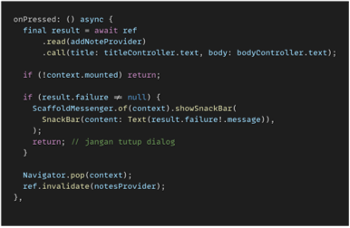
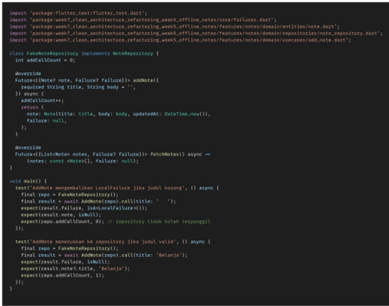
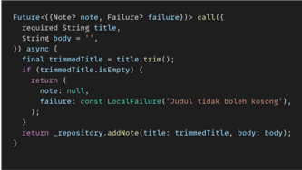
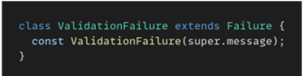
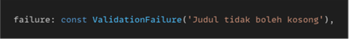
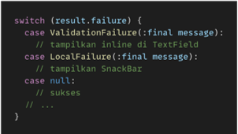
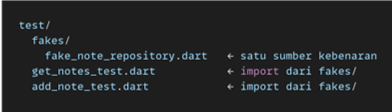
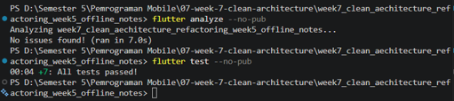
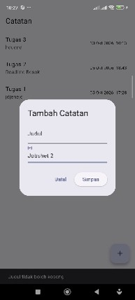

# PRAKTIKUM 1
### 1. Audit Riwayat

#### a. Commit langsung ke main
Seluruh 15 commit berada di branch main. Tidak ada branch develop maupun feature/*. Dampaknya, tidak ada tahap review sebelum kode masuk ke branch utama.
#### b. Pesan commit tidak deskriptif
Beberapa pesan commit hanya menyebut waktu, bukan perubahan yang dilakukan, misalnya Praktikum 1 Minggu 7 (muncul 3 kali, satu di antaranya typo “MInggu”), Praktikum 2 Minggu 7, dan Memperbaiki Tampilan Readme (muncul 3 kali). Dampaknya, riwayat sulit dilacak dan sulit di-revert.
#### c. Branch berumur Panjang
Tidak ditemukan. Repository hanya memiliki branch main, sehingga belum menerapkan Git Flow.
#### d. File untracked
Tidak ditemukan. Hasil git status menunjukkan working tree clean.

### 2. Buat branch kerja yang benar
#### a. Buat branch develop dari main
- git checkout -b develop 
 
 Membuat branch baru bernama develop dan langsung pindah ke branch itu. Branch baru ini salinan dari branch tempat kamu berada sekarang (yaitu main). Tanda -b artinya “buat baru”. 
- git push -u origin develop 
 
Mengirim branch develop dari laptop ke GitHub (origin). Tanda -u menghubungkan branch lokal dengan branch di GitHub, jadi nanti cukup mengetik git push atau git pull tanpa menyebut nama branch lagi. 
#### b. Buat branch fitur dari develop
- git checkout -b feat/notes-validation 
 
Sama seperti sebelumnya yaitu membuat branch baru feat/notes-validation dan pindah ke sana. Karena sedang di develop, branch fitur ini dibuat dari develop. Semua perubahanmu nanti aman di branch ini dan tidak mengganggu develop atau main. 
- git branch 
 
git branch menampilkan tiga branch lokal, yaitu main, develop, dan feat/notes-validation. Tanda * berada pada feat/notes-validation, artinya branch fitur tersebut sedang aktif dan dibuat dari develop. Branch main yang selalu siap dirilis dan branch develop untuk integrasi fitur tetap tidak berubah. 
#### c. Melakukan perubahan kecil
menambah validasi di file add_note.dart yaitu catatan dengan judul kosong tidak boleh disimpan. 
#### d. Simpan dengan commit yang rapi
- Cek Perubahan 
 
git push -u origin feat/notes-validation 
- git add -p 
 
Perintah git add -p digunakan untuk memilih perubahan secara bertahap (per potongan) sebelum dimasukkan ke commit. Git menampilkan satu potongan perubahan (1/1) berisi penambahan async dan validasi title.trim().isEmpty, lalu dijawab y agar masuk ke staging. 
- git commit -m "feat(notes): validasi judul kosong di use case AddNote" 
 
Perintah ini menyimpan perubahan yang sudah di-staging ke riwayat Git dengan pesan berformat tipe(scope): deskripsi. Hasilnya adalah commit 37094a6 dengan 1 file berubah, 4 baris ditambah, dan 1 baris dihapus. Pesan commit menjelaskan dengan jelas apa yang diubah dan di bagian mana. 
- git push -u origin feat/notes-validation 
 
Perintah ini mengirim branch feat/notes-validation dari laptop ke GitHub (origin). Opsi -u menghubungkan branch lokal dengan branch di GitHub sehingga selanjutnya cukup memakai git push. Hasil [new branch] feat/notes-validation -> feat/notes-validation menandakan push berhasil dan branch siap dibuatkan Pull Request 

### 3. Perbaiki satu commit buruk (simulasi)
a. **Sebelum**: Mengcopy projek minggu ke 5 ke project minggu 7 
**Sesudah**: chore(week7): salin project minggu 5 sebagai dasar refactoring 
**Alasan**: pesan lama sudah menjelaskan isi, tetapi belum memakai tipe dan scope. Tipe chore tepat karena ini tugas pendukung, bukan fitur. 

b. **Sebelum**: Memperbaiki Tampilan Readme 
**Sesudah**: docs(readme): rapikan tampilan dan format README 
**Alasan**: tipe docs langsung menunjukkan perubahan dokumentasi, dan scope readme menunjukkan lokasinya. 

c. **Sebelum**: Menghapus isi screenshot dan readme 
**Sesudah**: docs(readme): hapus isi README dan screenshot lama 
**Alasan**: pesan lama tidak memakai tipe. Tipe docs dan scope readme membuat jenis dan lokasi perubahan langsung terbaca 

# PRAKTIKUM 2
#### 1.	Membuat Issue
 
Issue dibuat di GitHub dengan judul Validasi judul kosong pada catatan dan diberi label bug. Isinya menjelaskan masalah, langkah reproduksi, dan hasil yang diharapkan. Issue ini mendapat nomor 1 dan menjadi awal dari seluruh alur kerja, sehingga setiap perubahan kode punya alasan yang jelas dan dapat dilacak.

#### 2.	Membuat Pull Request
 
Pull Request dibuat dari branch fitur ke branch develop sesuai aturan Git Flow. Judulnya memakai format commit konvensional. Deskripsinya berisi masalah, solusi, dan cara uji, lalu diakhiri kata kunci Closes dengan nomor issue 1 agar PR terhubung ke issue. Perubahan hanya mencakup satu file dan satu fitur sehingga mudah direview.

#### 3.	Hasil Setelah Close Issue
 
Setelah PR di merge ke develop, issue nomor 1 ditutup secara manual dengan status Close as completed. Penutupan otomatis tidak terjadi karena GitHub hanya menutup issue otomatis jika PR di merge ke default branch, yaitu main, sedangkan PR ini ditujukan ke develop. Status Closed menunjukkan masalah sudah selesai ditangani dan alur issue, branch, commit, PR, dan merge terdokumentasi dengan lengkap.

#### 4.	Hasil Git Checkout Develop dan Git Pull Origin Develop
 
Perintah git checkout develop digunakan untuk pindah ke branch develop di laptop. Perintah git pull origin develop kemudian mengambil hasil merge terbaru dari GitHub. Hasilnya berupa Fast forward dari commit 52a7496 ke 7ae69be tanpa konflik. Satu file berubah, yaitu add_note.dart, dengan 4 penambahan dan 1 penghapusan. Ini menunjukkan perubahan dari branch fitur sudah masuk ke develop dan develop di laptop sama dengan yang ada di GitHub.

# PRAKTIKUM 3
#### 1.	Hasil Pemeriksaan Mesin
 
Perintah dart format dijalankan pada folder lib dan test, dengan hasil Formatted 26 files dan 0 changed. Artinya seluruh file sudah rapi. Sebelumnya perintah ini merapikan 23 file, dan perubahan tersebut sudah di merge ke develop melalui Pull Request terpisah. Folder build tidak ikut diperiksa karena berisi hasil kompilasi dan bukan kode sumber. Perintah flutter analyze menunjukkan hasil No issues found, yang berarti tidak ada error, warning, maupun saran perbaikan pada kode. Perintah flutter test menunjukkan hasil All tests passed dengan 5 test, yang membuktikan bahwa perubahan format dan penambahan validasi judul kosong tidak merusak perilaku aplikasi.

#### 2.	Hasil Pull Request Format Kode
 
Pull Request nomor 3 dibuat dari branch chore/format-code ke branch develop untuk merapikan 23 file hasil dart format. Isi perubahan hanya format, tanpa perubahan logika. Status Merged menunjukkan perubahan sudah masuk ke develop melalui alur Pull Request sesuai Git Flow.

#### 3.	Hasil CI pada Pull Request
 
 
Workflow CI ci.yml dijalankan otomatis pada setiap Pull Request dan menjalankan flutter pub get, flutter analyze, serta flutter test. Run pertama gagal karena folder tmp_test_project, yaitu sisa percobaan yang ikut ter commit dan berisi test bawaan yang rusak. Setelah folder tersebut dihapus lewat commit kedua, job verify berhasil dalam waktu sekitar 1 menit 33 detik dan seluruh pemeriksaan lolos. Hal ini membuktikan CI mampu menangkap masalah yang tidak terlihat di laptop sebelum kode digabung. 

#### 4.	Hasil Pull Request CI Setelah Merge
  
Pull Request nomor 4 berhasil di merge ke branch develop dengan dua commit. Commit pertama menambahkan workflow CI dan ditandai gagal, sedangkan commit kedua menghapus folder tmp_test_project dan ditandai berhasil. Setelah merge, branch chore/add-ci dihapus agar daftar branch tetap pendek

#### 5.	Hasil Update Branch Develop
 
Branch develop di laptop diperbarui dengan git pull origin develop dan menghasilkan Fast forward tanpa konflik. File ci.yml masuk ke develop dan folder tmp_test_project hilang dari Git. Hasil git log menunjukkan commit merge Pull Request nomor 3 dan nomor 4 dengan pesan commit berformat konvensional, dan HEAD pada develop sama dengan origin develop.

#### 6.	Hasil Pemeriksaan Kesiapan Struktur
 
Pencarian import terlarang pada lapisan domain dan presentation tidak menemukan package Flutter, Dio, maupun SQLite. Pemeriksaan ulang dengan Get-ChildItem membaca empat file pada domain notes dan tetap tidak menemukan import terlarang. Dengan demikian dependency rule Clean Architecture terbukti dan struktur feature first siap dilanjutkan ke paruh kedua.

# AI CHALLENGE
### Promt
Review perubahan Flutter ini sebagai senior Flutter dev.
Jangan ubah, tulis, atau hapus file apa pun. Hanya baca dan beri review.

Konteks: feature-first Clean Architecture (presentation -> domain <- data),
Riverpod, GoRouter, SQLite + Dio.

Perubahan yang direview: validasi judul kosong pada use case AddNote 
di lib/features/notes/domain/usecases/add_note.dart.
Baca juga file terkait:
- lib/features/notes/presentation/widgets/add_note_dialog.dart
- lib/features/notes/data/repositories/note_repository_impl.dart
- lib/features/notes/presentation/providers/notes_providers.dart
- lib/core/failures.dart
- folder test/

Fokus: kebenaran, arsitektur, dan test. Abaikan style dan format.
Berikan 5 temuan teratas, masing-masing berisi:
level (blocker/saran), file dan baris, alasan, dan usulan potongan kode perbaikan (hanya ditampilkan, jangan diterapkan).

### Hasil
**Code Review: Validasi Judul Kosong pada AddNote Use Case**
**5 Temuan Teratas**
#### 1.	BLOCKER — UI tidak menangani failure dari use case
File: add_note_dialog.dart
Alasan: Dialog langsung Navigator.pop setelah memanggil addNote, tanpa memeriksa result.failure. Jika user mengirim judul kosong, validasi di use case mengembalikan Failure, tapi dialog tetap menutup tanpa feedback apapun validasi jadi sia-sia. 
Usulan perbaikan: 

#### 2.	BLOCKER — Tidak ada unit test untuk AddNote use case
File: Folder test/
Alasan: Test yang ada hanya menguji GetNotes (use case) dan NoteRepositoryImpl (data layer). Perubahan inti — yaitu validasi title.trim().isEmpty di AddNote — sama sekali belum punya test. Ini artinya regresi bisa masuk tanpa terdeteksi. FakeNoteRepository di get_notes_test.dart sudah meng-implement addNote tapi hanya throw UnimplementedError(). 
Usulan perbaikan (file baru test/add_note_test.dart): 

#### 3.	SARAN — Use case meneruskan title tanpa di-trim ke repository
File: add_note.dart (baris 20)
Alasan: Validasi menggunakan title.trim().isEmpty, artinya " Halo " lolos validasi (benar), tapi string asli termasuk spasi leading/trailing diteruskan ke repository dan disimpan ke DB. Ini inkonsisten — kalau whitespace dianggap tidak bermakna untuk validasi, seharusnya juga di-trim sebelum disimpan. 
Usulan perbaikan: 
 

#### 4.	SARAN — Failure bisa dibuatkan subclass ValidationFailure agar domain lebih ekspresif
File: failures.dart & add_note.dart (baris 17)
Alasan: Saat ini validasi mengembalikan LocalFailure, yang semantiknya sama dengan kegagalan database. Presentation layer tidak bisa membedakan "judul kosong" (tampilkan inline error) vs "database rusak" (tampilkan snackbar/dialog). Dengan sealed class, menambah subclass tetap exhaustive-safe. 
Usulan perbaikan pada failures.dart: 
 
Lalu di add_note.dart: 
 
Ini memungkinkan pattern matching di UI: 

#### 5.	SARAN — FakeNoteRepository diduplikasi, sebaiknya di-share
File: get_notes_test.dart (baris 7–31)
Alasan: FakeNoteRepository saat ini terdefinisi langsung di file test GetNotes. Ketika nanti dibuat test untuk AddNote (temuan #2), fake ini perlu diduplikasi atau dibuat versi baru. Lebih baik diekstrak ke file shared agar konsisten dan DRY. 
Usulan perbaikan: 

### AI Verification Checklist
#### 1.	Apakah temuan benar-benar ada? Buktikan dengan grep, test gagal, atau reproduksi manual.
- Temuan 1 (UI mengabaikan failure): terbukti benar.
Bukti: saat catatan ditambahkan tanpa judul dan hanya mengisi bagian isi, tombol Simpan ditekan, dialog menutup tanpa pesan error dan catatan tidak muncul. Pembacaan kode add_note_dialog.dart menguatkan hal ini karena dialog langsung memanggil Navigator.pop tanpa memeriksa result.failure. Validasi pada use case berjalan, tetapi pengguna tidak mendapat umpan balik.
- Temuan 2 (tidak ada test AddNote): terbukti benar.
Bukti: perintah Get-ChildItem -Recurse test -Filter *.dart | Select-String "AddNote" hanya menemukan method addNote milik FakeNoteRepository dan pemanggilan repository.addNote pada test repository. Tidak ada test yang menguji class use case AddNote. Setelah file test/add_note_test.dart dibuat, flutter test menampilkan 7 test lulus (5 lama dan 2 baru).
- Temuan 3 sampai 5 secara teknis valid, tetapi bersifat saran dan tidak diuji karena berada di luar cakupan perubahan.

#### 2.	Apakah usulan melanggar dependency rule (domain mengimpor Flutter/Dio/SQLite)? Tolak bila ya.
Usulan perbaikan tidak melanggar dependency rule.
- Perbaikan temuan 1 hanya mengubah lapisan presentation (add_note_dialog.dart), yang memang boleh mengimpor Flutter.
- Test temuan 2 berada di folder test dan hanya mengimpor entitas, repository abstrak, dan use case dari lapisan domain.
- Lapisan domain tidak menerima import Flutter, Dio, maupun SQLite. Hal ini diperiksa dengan Select-String dan hasilnya kosong.

#### 3.	Apakah AI hanya nitpick style yang seharusnya ditangani formatter/CI?
Tidak. Dua temuan teratas menyangkut perilaku aplikasi (umpan balik kepada pengguna) dan kualitas pengujian, bukan format. Temuan 3 sampai 5 juga berkaitan dengan desain dan struktur test, bukan spasi atau gaya penulisan. Persoalan format memang ditangani terpisah oleh dart format dan CI.

#### 4.	Minimal 2 temuan AI terbukti benar dengan bukti, dan minimal 1 temuan ditolak dengan alasan tertulis.
- Temuan 1: UI mengabaikan failure (Blocker)
Keputusan: Diterima. Alasan: terbukti lewat reproduksi manual, dan perbaikan diuji ulang hingga pesan error muncul.
- Temuan 2: Tidak ada test AddNote (Blocker)
Keputusan: Diterima. Alasan: terbukti lewat pencarian, lalu dibuktikan dengan 7 test lulus.
- Temuan 3: Title tidak di-trim (Saran)
Keputusan: Ditunda. Alasan: valid, tetapi mengubah perilaku penyimpanan data dan melebar dari cakupan PR.
- Temuan 4: ValidationFailure (Saran)
Keputusan: Ditolak. Alasan: lihat bagian 5.
- Temuan 5: FakeNoteRepository dibagikan antar test (Saran)
Keputusan: Ditunda. Alasan: merupakan refactor test, bukan bug, dan di luar cakupan PR.

#### 5.	Keputusan final dan alasan teknis Anda, boleh berbeda dari saran AI selama berargumen.
Temuan 4 (membuat subclass ValidationFailure) ditolak.
Alasan teknis:
- Baru ada satu jenis validasi, sehingga penambahan kelas baru tergolong berlebihan (over-engineering) dan belum dibutuhkan.
- Failure adalah sealed class. Menambah subclass dapat memengaruhi switch di bagian lain yang bersifat exhaustive, dan dampak ini perlu pemeriksaan tersendiri.
- PR ini dirancang kecil dan fokus pada satu perubahan. Usulan ini memperluas cakupan ke lapisan core.
- LocalFailure dengan pesan yang jelas sudah cukup, terbukti dari SnackBar yang menampilkan “Judul tidak boleh kosong” saat diuji.
#### 6.	Flutter Analyze dan Flutter Test

# REFACTORING CHALLENGE
#### 1.	Flutter Analyze dan Flutter Test

#### 2.	Langkah Manual Uji Fitur Validasi Judul Kosong
 
Uji manual dilakukan dengan menjalankan aplikasi menggunakan perintah flutter run, lalu membuka dialog Tambah Catatan. Kolom judul dikosongkan dan hanya kolom isi yang diisi, kemudian tombol Simpan ditekan. Sebelum perbaikan, dialog langsung menutup tanpa pesan apa pun dan catatan tidak muncul di daftar, sehingga pengguna tidak mengetahui penyebab kegagalan. Setelah perbaikan, dialog tetap terbuka dan muncul pesan Judul tidak boleh kosong di bagian bawah layar melalui SnackBar. Catatan juga tidak tersimpan ke daftar. Hasil ini membuktikan validasi pada use case AddNote bekerja dan kegagalannya kini ditampilkan kepada pengguna.

# REFLEKSI
#### 1.	Apa beda LGTM buta dengan approve yang bertanggung jawab? Apa risikonya bagi tim?
LGTM buta berarti menyetujui perubahan tanpa membaca diff, tanpa menjalankan kode, dan tanpa menguji perilakunya. Approve yang bertanggung jawab berarti reviewer membaca perubahan, menjalankan kode, memeriksa kasus gagal, dan baru menyetujui setelah yakin. Risiko LGTM buta bagi tim adalah bug lolos ke develop, kualitas kode menurun, dan reviewer ikut menanggung kesalahan yang tidak ia periksa. Dari praktikum ini saya memahami bahwa mesin seperti CI sekalipun hanya menangkap masalah yang mekanis, sehingga penilaian logika tetap membutuhkan reviewer yang sungguh-sungguh membaca.

#### 2.	Kapan komentar wajib berstatus request changes, dan kapan cukup saran?
Request changes wajib digunakan ketika temuan dapat merusak perilaku atau aturan penting, misalnya bug logika, kegagalan yang tidak ditangani, pelanggaran dependency rule, atau perubahan perilaku tanpa test. Saran cukup digunakan untuk perbaikan yang bersifat peningkatan kualitas dan tidak menimbulkan kesalahan, misalnya penamaan, refactor kecil, atau berbagi fake antar test. Sebagai contoh, temuan AI bahwa dialog mengabaikan failure saya anggap blocker karena pengguna tidak mendapat umpan balik, sedangkan usulan ValidationFailure hanya saran.

#### 3.	Bagian mana dari review AI yang Anda tolak atau sederhanakan, dan mengapa?
Saya menolak usulan membuat subclass ValidationFailure. Alasannya, baru ada satu jenis validasi sehingga penambahan kelas tergolong berlebihan. Selain itu, Failure adalah sealed class, sehingga penambahan subclass dapat memengaruhi switch di bagian lain, dan usulan ini melebar dari cakupan PR yang dirancang kecil. Saya juga menunda usulan men-trim judul dan berbagi FakeNoteRepository karena berada di luar cakupan perubahan. Dari sini saya belajar bahwa saran AI perlu diverifikasi dan tidak otomatis diterapkan.

#### 4.	Satu hal konkret yang Anda perbaiki setelah review, dan apa dampaknya?
Saya memperbaiki add_note_dialog.dart agar memeriksa result.failure dan menampilkan SnackBar tanpa menutup dialog. Sebelumnya, dialog menutup tanpa pesan sehingga pengguna tidak tahu penyebab catatan tidak tersimpan. Setelah perbaikan, pesan “Judul tidak boleh kosong” muncul dan pengguna dapat langsung memperbaiki input. Saya juga menambah dua test untuk AddNote sehingga jumlah test menjadi 7 dan validasi kini terlindungi dari regresi.
