# PRAKTIKUM 1
### 1. Audit Riwayat
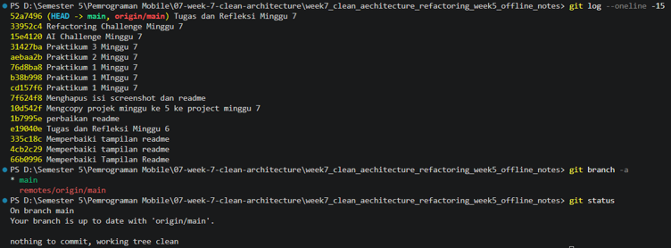
#### a. Commit langsung ke main
Seluruh 15 commit berada di branch main. Tidak ada branch develop maupun feature/*. Dampaknya, tidak ada tahap review sebelum kode masuk ke branch utama.
#### b. Pesan commit tidak deskriptif
Beberapa pesan commit hanya menyebut waktu, bukan perubahan yang dilakukan, misalnya Praktikum 1 Minggu 7 (muncul 3 kali, satu di antaranya typo “MInggu”), Praktikum 2 Minggu 7, dan Memperbaiki Tampilan Readme (muncul 3 kali). Dampaknya, riwayat sulit dilacak dan sulit di-revert.
#### c. Branch berumur Panjang
Tidak ditemukan. Repository hanya memiliki branch main, sehingga belum menerapkan Git Flow.
#### d. File untracked
Tidak ditemukan. Hasil git status menunjukkan working tree clean.

### 2. Buat branch kerja yang benar
#### a. Buat branch develop dari main
- git checkout -b develop 
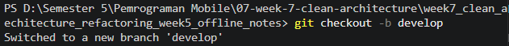 
 Membuat branch baru bernama develop dan langsung pindah ke branch itu. Branch baru ini salinan dari branch tempat kamu berada sekarang (yaitu main). Tanda -b artinya “buat baru”. 
- git push -u origin develop 
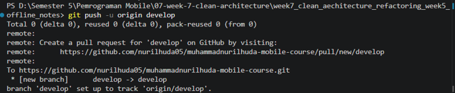 
Mengirim branch develop dari laptop ke GitHub (origin). Tanda -u menghubungkan branch lokal dengan branch di GitHub, jadi nanti cukup mengetik git push atau git pull tanpa menyebut nama branch lagi. 
#### b. Buat branch fitur dari develop
- git checkout -b feat/notes-validation 
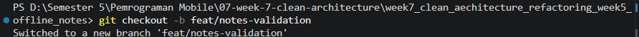 
Sama seperti sebelumnya yaitu membuat branch baru feat/notes-validation dan pindah ke sana. Karena sedang di develop, branch fitur ini dibuat dari develop. Semua perubahanmu nanti aman di branch ini dan tidak mengganggu develop atau main. 
- git branch 
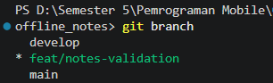 
git branch menampilkan tiga branch lokal, yaitu main, develop, dan feat/notes-validation. Tanda * berada pada feat/notes-validation, artinya branch fitur tersebut sedang aktif dan dibuat dari develop. Branch main yang selalu siap dirilis dan branch develop untuk integrasi fitur tetap tidak berubah. 
#### c. Melakukan perubahan kecil
menambah validasi di file add_note.dart yaitu catatan dengan judul kosong tidak boleh disimpan. 
#### d. Simpan dengan commit yang rapi
- Cek Perubahan 
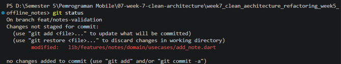 
git push -u origin feat/notes-validation 
- git add -p 
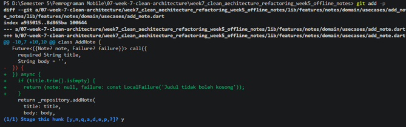 
Perintah git add -p digunakan untuk memilih perubahan secara bertahap (per potongan) sebelum dimasukkan ke commit. Git menampilkan satu potongan perubahan (1/1) berisi penambahan async dan validasi title.trim().isEmpty, lalu dijawab y agar masuk ke staging. 
- git commit -m "feat(notes): validasi judul kosong di use case AddNote" 
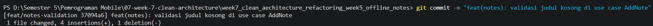 
Perintah ini menyimpan perubahan yang sudah di-staging ke riwayat Git dengan pesan berformat tipe(scope): deskripsi. Hasilnya adalah commit 37094a6 dengan 1 file berubah, 4 baris ditambah, dan 1 baris dihapus. Pesan commit menjelaskan dengan jelas apa yang diubah dan di bagian mana. 
- git push -u origin feat/notes-validation 
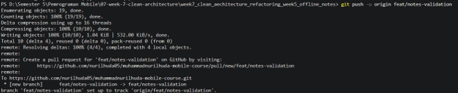 
Perintah ini mengirim branch feat/notes-validation dari laptop ke GitHub (origin). Opsi -u menghubungkan branch lokal dengan branch di GitHub sehingga selanjutnya cukup memakai git push. Hasil [new branch] feat/notes-validation -> feat/notes-validation menandakan push berhasil dan branch siap dibuatkan Pull Request 

### 3. Perbaiki satu commit buruk (simulasi)
a. **Sebelum**: Mengcopy projek minggu ke 5 ke project minggu 7 
**Sesudah**: chore(week7): salin project minggu 5 sebagai dasar refactoring 
**Alasan**: pesan lama sudah menjelaskan isi, tetapi belum memakai tipe dan scope. Tipe chore tepat karena ini tugas pendukung, bukan fitur. 

b. **Sebelum**: Memperbaiki Tampilan Readme 
**Sesudah**: docs(readme): rapikan tampilan dan format README 
**Alasan**: tipe docs langsung menunjukkan perubahan dokumentasi, dan scope readme menunjukkan lokasinya. 

c. **Sebelum**: Menghapus isi screenshot dan readme 
**Sesudah**: docs(readme): hapus isi README dan screenshot lama 
**Alasan**: pesan lama tidak memakai tipe. Tipe docs dan scope readme membuat jenis dan lokasi perubahan langsung terbaca 

# PRAKTIKUM 2
#### 1.	Membuat Issue
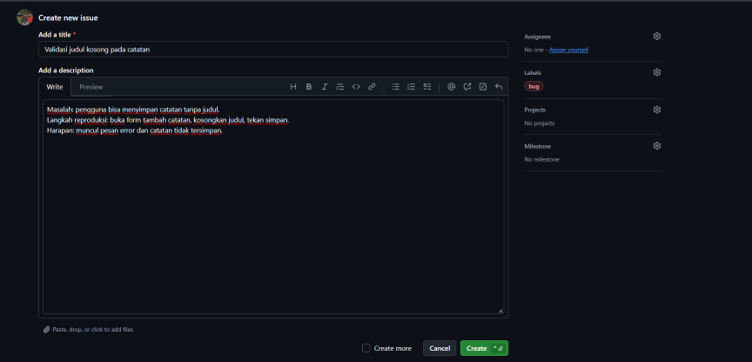 
Issue dibuat di GitHub dengan judul Validasi judul kosong pada catatan dan diberi label bug. Isinya menjelaskan masalah, langkah reproduksi, dan hasil yang diharapkan. Issue ini mendapat nomor 1 dan menjadi awal dari seluruh alur kerja, sehingga setiap perubahan kode punya alasan yang jelas dan dapat dilacak.

#### 2.	Membuat Pull Request
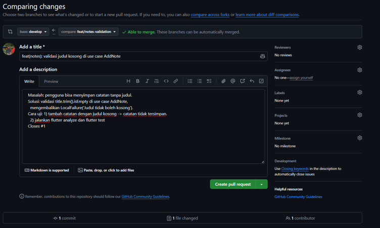 
Pull Request dibuat dari branch fitur ke branch develop sesuai aturan Git Flow. Judulnya memakai format commit konvensional. Deskripsinya berisi masalah, solusi, dan cara uji, lalu diakhiri kata kunci Closes dengan nomor issue 1 agar PR terhubung ke issue. Perubahan hanya mencakup satu file dan satu fitur sehingga mudah direview.

#### 3.	Hasil Setelah Close Issue
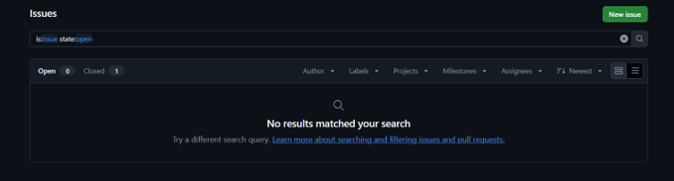 
Setelah PR di merge ke develop, issue nomor 1 ditutup secara manual dengan status Close as completed. Penutupan otomatis tidak terjadi karena GitHub hanya menutup issue otomatis jika PR di merge ke default branch, yaitu main, sedangkan PR ini ditujukan ke develop. Status Closed menunjukkan masalah sudah selesai ditangani dan alur issue, branch, commit, PR, dan merge terdokumentasi dengan lengkap.

#### 4.	Hasil Git Checkout Develop dan Git Pull Origin Develop
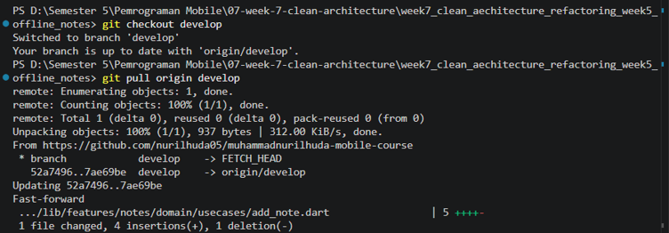 
Perintah git checkout develop digunakan untuk pindah ke branch develop di laptop. Perintah git pull origin develop kemudian mengambil hasil merge terbaru dari GitHub. Hasilnya berupa Fast forward dari commit 52a7496 ke 7ae69be tanpa konflik. Satu file berubah, yaitu add_note.dart, dengan 4 penambahan dan 1 penghapusan. Ini menunjukkan perubahan dari branch fitur sudah masuk ke develop dan develop di laptop sama dengan yang ada di GitHub.

# PRAKTIKUM 3
#### 1.	Hasil Pemeriksaan Mesin
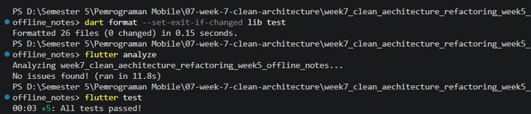 
Perintah dart format dijalankan pada folder lib dan test, dengan hasil Formatted 26 files dan 0 changed. Artinya seluruh file sudah rapi. Sebelumnya perintah ini merapikan 23 file, dan perubahan tersebut sudah di merge ke develop melalui Pull Request terpisah. Folder build tidak ikut diperiksa karena berisi hasil kompilasi dan bukan kode sumber. Perintah flutter analyze menunjukkan hasil No issues found, yang berarti tidak ada error, warning, maupun saran perbaikan pada kode. Perintah flutter test menunjukkan hasil All tests passed dengan 5 test, yang membuktikan bahwa perubahan format dan penambahan validasi judul kosong tidak merusak perilaku aplikasi.

#### 2.	Hasil Pull Request Format Kode
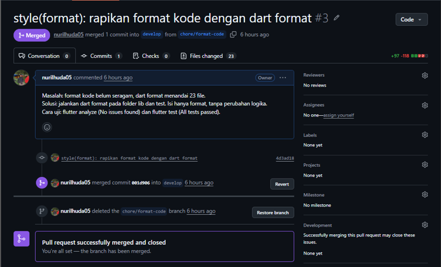 
Pull Request nomor 3 dibuat dari branch chore/format-code ke branch develop untuk merapikan 23 file hasil dart format. Isi perubahan hanya format, tanpa perubahan logika. Status Merged menunjukkan perubahan sudah masuk ke develop melalui alur Pull Request sesuai Git Flow.

#### 3.	Hasil CI pada Pull Request
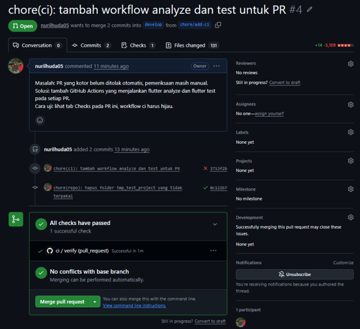 
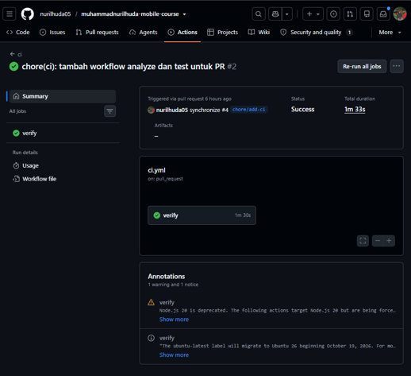 
Workflow CI ci.yml dijalankan otomatis pada setiap Pull Request dan menjalankan flutter pub get, flutter analyze, serta flutter test. Run pertama gagal karena folder tmp_test_project, yaitu sisa percobaan yang ikut ter commit dan berisi test bawaan yang rusak. Setelah folder tersebut dihapus lewat commit kedua, job verify berhasil dalam waktu sekitar 1 menit 33 detik dan seluruh pemeriksaan lolos. Hal ini membuktikan CI mampu menangkap masalah yang tidak terlihat di laptop sebelum kode digabung. 

#### 4.	Hasil Pull Request CI Setelah Merge
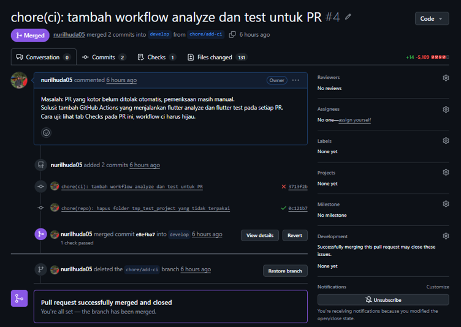  
Pull Request nomor 4 berhasil di merge ke branch develop dengan dua commit. Commit pertama menambahkan workflow CI dan ditandai gagal, sedangkan commit kedua menghapus folder tmp_test_project dan ditandai berhasil. Setelah merge, branch chore/add-ci dihapus agar daftar branch tetap pendek

#### 5.	Hasil Update Branch Develop
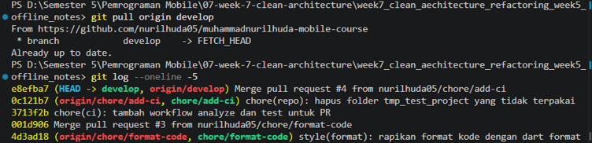 
Branch develop di laptop diperbarui dengan git pull origin develop dan menghasilkan Fast forward tanpa konflik. File ci.yml masuk ke develop dan folder tmp_test_project hilang dari Git. Hasil git log menunjukkan commit merge Pull Request nomor 3 dan nomor 4 dengan pesan commit berformat konvensional, dan HEAD pada develop sama dengan origin develop.

#### 6.	Hasil Pemeriksaan Kesiapan Struktur
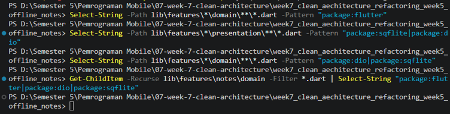 
Pencarian import terlarang pada lapisan domain dan presentation tidak menemukan package Flutter, Dio, maupun SQLite. Pemeriksaan ulang dengan Get-ChildItem membaca empat file pada domain notes dan tetap tidak menemukan import terlarang. Dengan demikian dependency rule Clean Architecture terbukti dan struktur feature first siap dilanjutkan ke paruh kedua.
