# PRAKTIKUM 2

## Promt

PERAN:
Kamu adalah senior Flutter developer.

KONTEKS:
Proyek memakai feature-first, Riverpod, SQLite + Dio.
Arsitektur: presentation -> domain <- data.

[Struktur folder (lib)]
lib/
  main.dart
  routes.dart
  core/
    failures.dart
    format.dart
    database/database_helper.dart
  features/
    announcements/ (data, domain, presentation)
    notes/
      data/
        models/note_model.dart
        repositories/note_repository_impl.dart
      domain/
        entities/note.dart
        repositories/note_repository.dart
        usecases/add_note.dart
        usecases/get_notes.dart
      presentation/
        pages/notes_page.dart
        providers/notes_providers.dart
        widgets/add_note_dialog.dart
        widgets/error_view.dart
        widgets/notes_list.dart

[File kontrak repository: note_repository.dart]
import '../../domain/entities/note.dart';
import '../../../../core/failures.dart';

abstract class NoteRepository {
  Future<({List<Note> notes, Failure? failure})> fetchNotes();

  Future<({Note? note, Failure? failure})> addNote({
    required String title,
    String body = '',
  });
}

[Versi package dari pubspec.yaml]
dependencies:
  flutter_riverpod: ^3.4.3
  shared_preferences: ^2.5.5
  sqflite: ^2.4.4
  path: ^1.9.1
  dio: ^5.11.1
  go_router: ^18.0.1
dev_dependencies:
  flutter_lints: ^6.0.0
  sqflite_common_ffi: ^2.4.3

TUGAS:
Tambah search judul notes + empty state.
Jangan panggil SQLite dari widget.

BATAS:
- Jangan ubah arsitektur yang sudah ada.
- Maksimal 80 baris kode.
- Hal yang TIDAK boleh diubah: kontrak NoteRepository (note_repository.dart) yang sudah ada.

OUTPUT:
- Kode fitur search judul notes + empty state.
- 3 test case (termasuk 1 widget test untuk empty state).
- Cara menguji fitur.

## Hasil AI

Fitur pencarian judul selesai. Pencarian berjalan di memori pada daftar notes yang sudah dimuat; widget tidak mengakses SQLite dan kontrak NoteRepository tidak berubah.

Implementasi dan empty state ada di notes_page.dart.
Tiga test—pencarian tanpa membedakan kapitalisasi, query kosong, dan widget test empty state—ada di notes_search_test.dart.
Validasi: flutter test lulus (10 test); flutter analyze tidak menemukan masalah.

## Verifikasi Hasil AI
#### 1. Uji Manual: Query Kosong
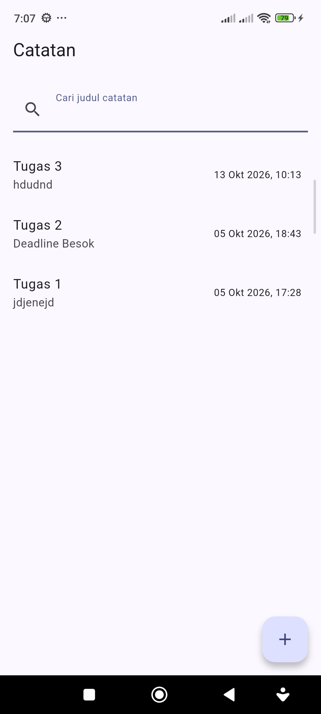 
Saat kolom pencarian kosong, semua catatan tampil.

#### 2. Uji Manual: Query Cocok
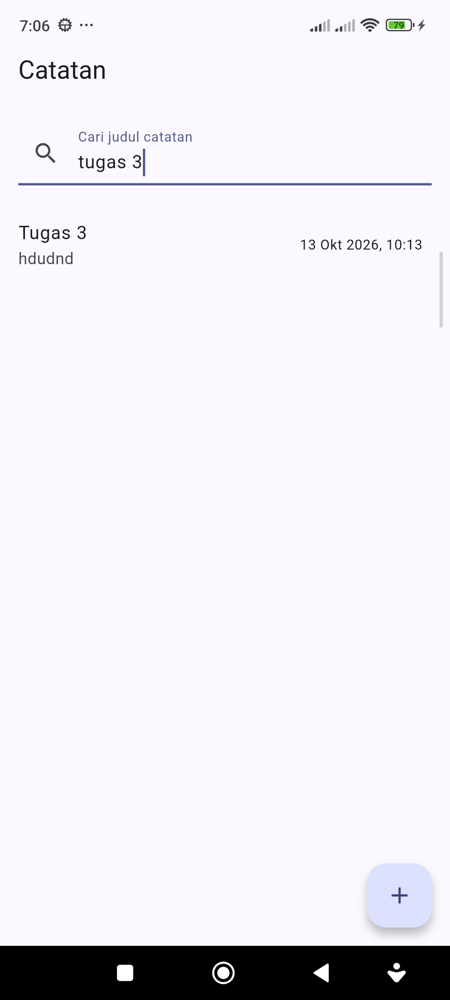 
Hanya catatan yang judulnya mengandung kata kunci yang tampil.

#### 3. Uji Manual: Query Tak Cocok
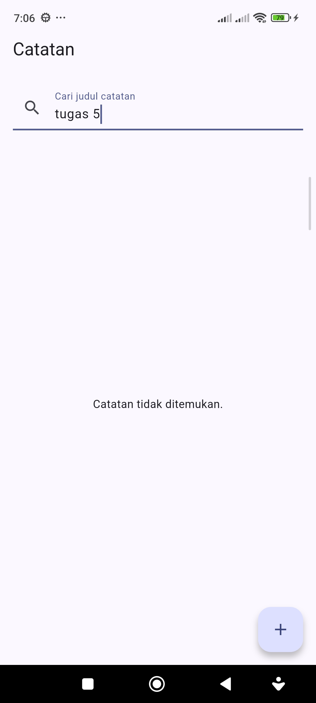 
Muncul empty state "Catatan tidak ditemukan.".

#### 4. Hasil flutter analyze dan flutter test
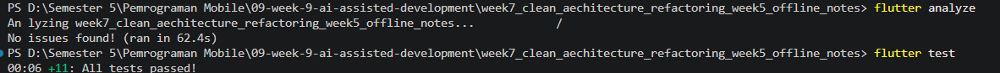 
`flutter analyze` menunjukkan No issues found, dan `flutter test` menunjukkan semua test lulus.

#### 5. Bukti 1 dan 2: Celah Arsitektur dan Celah Test
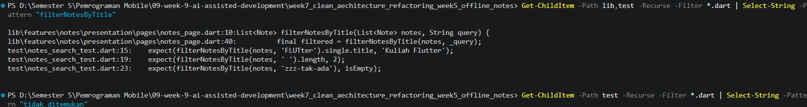 
Pencarian `filterNotesByTitle` menunjukkan fungsi berada di `notes_page.dart` (lapisan presentation), padahal seharusnya di use case domain. Pencarian `tidak ditemukan` di folder `test` hasilnya kosong, artinya teks "Catatan tidak ditemukan." belum punya widget test.

# PRAKTIKUM 3

## Debug dengan Test Merah
#### 1. Reproduksi
Saya melakukan reproduksi dengan membuka halaman Catatan, kemudian mengetikkan `zzz-tak-ada` pada kolom pencarian. Hasil yang saya harapkan adalah tampilnya teks "Catatan tidak ditemukan.", dan hasil yang saya amati pada layar sesuai dengan harapan tersebut.

#### 2. Isolasi
Bagian yang saya isolasi adalah fungsi `filterNotesByTitle` pada `notes_page.dart` baris 10. Fungsi ini bersifat murni sehingga dapat saya uji langsung tanpa UI melalui unit test. Adapun pemilihan teks empty state di dalam `build` belum teruji dan memerlukan widget test.

#### 3. Test Widget Empty State
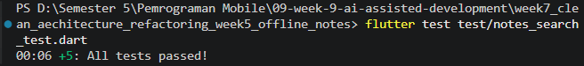 
Saya menambahkan widget test `query tak cocok menampilkan empty state` pada `test/notes_search_test.dart`. Hasil pengujian menunjukkan seluruh test pada file tersebut lulus (5 test). Test tidak berstatus merah karena saya tidak menemukan bug logika pada kode.

#### 4. Hasil Mesin: flutter test dan flutter analyze
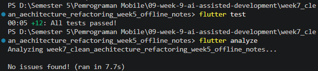 
Saya menjalankan `flutter test` untuk seluruh proyek dan hasilnya 12 test lulus. Saya juga menjalankan `flutter analyze` dan tidak ditemukan masalah (No issues found).

#### 5. Akar Masalah
Akar masalah yang saya temukan adalah celah pengujian, yaitu cabang "Catatan tidak ditemukan." sudah berfungsi benar tetapi belum memiliki test otomatis. Temuan ini bukan bug logika sehingga saya tidak mengubah kode. Saya menutup celah tersebut dengan menambahkan widget test.

## Refactor ke Layer yang Benar
#### 1. Kondisi Sebelum Refactor
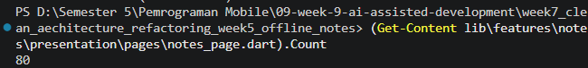 
Sebelum refactor, fungsi `filterNotesByTitle` berada di `notes_page.dart` (lapisan presentation), sedangkan aturan filter seharusnya berada di use case domain. Saya juga mengukur bahwa file `notes_page.dart` berisi 80 baris dan method `build` berukuran 52 baris (baris 20-71), melebihi batas 40 baris dari modul. Pengecekan database dari widget menunjukkan tidak ada panggilan SQLite pada `pages/` maupun `widgets/`. Import `database_helper.dart` pada `notes_providers.dart` hanya berfungsi sebagai wiring repository.

#### 2. Use Case SearchNotes di Domain
Saya memindahkan aturan filter ke use case `SearchNotes` pada `domain/usecases/search_notes.dart`. Use case ini murni Dart dan disambungkan ke presentation melalui `searchNotesProvider`. Fungsi `filterNotesByTitle` saya hapus dari `notes_page.dart`, dan kontrak `NoteRepository` tidak saya ubah. Test saya arahkan ke `SearchNotes`, sehingga jumlah test tetap 12.

#### 3. Pemecahan Method build
Saya memecah `build` dengan membuat widget `NotesSearchField` dan `NotesEmptyState`. Panjang `build` turun dari 52 baris menjadi 41 baris setelah `NotesSearchField`, lalu menjadi 36 baris setelah `NotesEmptyState`. Setelah `dart format`, panjangnya menjadi 37 baris (baris 22-58), sudah di bawah batas 40 baris.

#### 4. Pengecekan Batas Layer
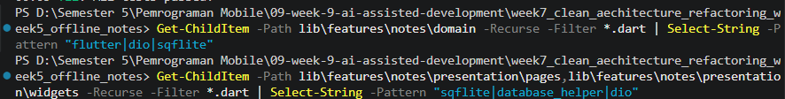 
Pencarian `flutter|dio|sqflite` pada folder `domain/` menghasilkan keluaran kosong, sehingga domain bebas dari Flutter, Dio, dan SQLite. Pencarian `sqflite|database_helper|dio` pada `pages/` dan `widgets/` juga kosong, sehingga tidak ada panggilan database dari widget.

## Verifikasi Akhir
#### 5. Hasil analyze, format, dan test
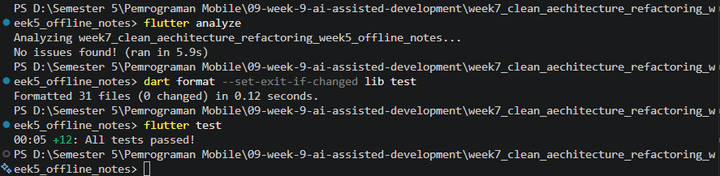 
Saya menjalankan `flutter analyze` dan hasilnya No issues found. Saya menjalankan `dart format --set-exit-if-changed lib test` hingga tidak ada file yang berubah. Saya juga menjalankan `flutter test` dan hasilnya 12 test lulus. Pada proyek ini `dart format` saya batasi ke folder `lib` dan `test`, karena perintah `dart format .` gagal membaca path di folder `build/` (hasil kompilasi Android) dan bukan karena kode saya.

# AI PROMPT CHALLENGE

## Prompt
Review kode search Flutter ini sebagai seniordev.

Konteks: feature-first (presentation -> domain <- data), Riverpod, SQLite + Dio.

Fokus: kebenaran, arsitektur, test. Abaikan style.

Beri 3 temuan + level blocker/saran + alasan.

## Hasil
Review statis: tidak ada temuan blocker, tetapi ada tiga saran yang layak ditangani.

#### Temuan 1
- Level: Saran
- Lokasi: `notes_page.dart`
- Temuan dan alasan: Query bisa tidak cocok dengan isi kolom pencarian setelah pemulihan error. `_query` disimpan di state halaman, tetapi `TextField` tidak memakai controller. Jika pemuatan catatan gagal setelah pencarian, field diganti tampilan error; saat retry berhasil, field dibuat ulang dalam keadaan kosong sementara daftar tetap difilter memakai `_query` lama. Simpan dan pulihkan nilai input melalui controller atau reset query saat state berubah.

#### Temuan 2
- Level: Saran
- Lokasi: `search_notes.dart`, `note_repository_impl.dart`
- Temuan dan alasan: Pencarian selalu memindai seluruh catatan di memori. Repository mengambil semua baris SQLite, lalu use case memeriksa judul untuk setiap input keystroke. Ini sederhana dan wajar untuk jumlah catatan kecil, tetapi biaya baca dan filter meningkat seiring ukuran data. Jika jumlah catatan dapat bertambah besar, pertimbangkan meneruskan query melalui use case/repository dan melakukan pencarian di SQLite.

#### Temuan 3
- Level: Saran
- Lokasi: `notes_search_test.dart`
- Temuan dan alasan: Belum ada widget test untuk hasil pencarian yang cocok. Test unit memeriksa pencocokan use case, tetapi widget test hanya mencakup daftar kosong dan query tanpa hasil. Tambahkan test yang memastikan query cocok menampilkan catatan yang benar dan menyembunyikan catatan lain agar wiring UI ikut teruji.

## Keputusan Terima atau Tolak
#### Temuan 1: _query tidak sinkron dengan field setelah error/retry
- Keputusan: Terima, perbaiki setelah dibuktikan dengan test.
- Alasan teknis: `TextField` tidak memakai controller dan berada di dalam cabang `data:`, sehingga ikut dibuat ulang saat state berpindah ke loading atau error. Sementara itu `_query` berada di State halaman yang tetap hidup. Klaim ini baru saya anggap benar setelah saya buktikan dengan test.

#### Temuan 2: pencarian memindai seluruh catatan di memori
- Keputusan: Tolak.
- Alasan teknis: Jumlah catatan pada aplikasi ini kecil, sehingga pencarian di memori sudah memadai. Memindahkan pencarian ke SQLite akan mengubah kontrak `NoteRepository`, padahal pada batas prompt saya kontrak tersebut tidak boleh diubah.

#### Temuan 3: belum ada widget test untuk query cocok
- Keputusan: Terima.
- Alasan teknis: Test unit hanya menguji use case, sedangkan wiring UI untuk hasil yang cocok belum teruji. Saya menambahkan widget test yang memastikan catatan yang cocok tampil dan catatan lain tersembunyi.

#### Keputusan per file
- `notes_page.dart`: terima + perbaiki (temuan 1, setelah dibuktikan).
- `notes_search_test.dart`: terima + tambah test (temuan 3).
- `search_notes.dart` dan `note_repository_impl.dart`: tidak diubah (temuan 2 ditolak).

## Pembuktian dan Perbaikan Temuan AI

#### 1. Temuan 3: Widget Test Query Cocok
Saya menambahkan widget test `query cocok menampilkan catatan yang sesuai saja` pada `test/notes_search_test.dart`. Test ini memastikan catatan "Kuliah Flutter" tampil dan catatan "Belanja" tersembunyi saat query `flutter`. Hasilnya 13 test lulus.

#### 2. Temuan 1: Test Merah sebagai Bukti
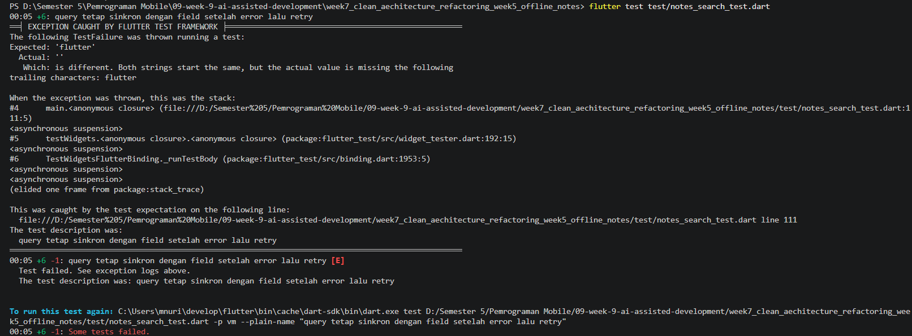 
Untuk membuktikan temuan 1, saya menambahkan test `query tetap sinkron dengan field setelah error lalu retry`. Test tersebut gagal dengan pesan `Expected: 'flutter'` dan `Actual: ''` pada baris 111. Artinya setelah error lalu retry berhasil, kolom pencarian kosong kembali sementara `_query` masih berisi `flutter`, sehingga klaim AI terbukti benar.

#### 3. Akar Masalah dan Perbaikan
Akar masalahnya adalah `TextField` tidak memakai controller dan berada di dalam cabang `data:`, sehingga dibuat ulang kosong saat state berpindah ke loading atau error, sedangkan `_query` tetap berada di State halaman. Saya memperbaikinya dengan menyimpan `TextEditingController` di `_NotesPageState` dan memberikannya ke `NotesSearchField`.

#### 4. Hasil Mesin Setelah Perbaikan
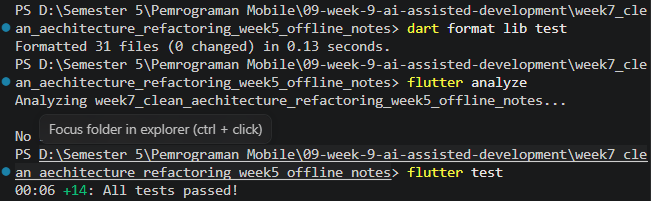 
Setelah perbaikan, `flutter analyze` menunjukkan No issues found dan `flutter test` menunjukkan 14 test lulus. Panjang method `build` menjadi 39 baris (baris 29-67), masih di bawah batas 40 baris.

# REFLEKSI
#### 1. Satu halusinasi AI apa yang Anda temukan dan bagaimana membuktikannya?
Pada praktikum ini saya tidak menemukan halusinasi API seperti method fiktif atau package kadaluarsa. Temuan yang paling mendekati adalah logika yang terlihat yakin tetapi salah, yaitu kolom pencarian dan `_query` tidak sinkron setelah terjadi error lalu retry. Saya membuktikannya dengan menulis widget test yang gagal dengan pesan `Expected: 'flutter'` dan `Actual: ''`. Setelah itu saya memperbaikinya dengan menyimpan `TextEditingController` di State halaman, sehingga test berubah hijau.

#### 2. Prompt mana yang paling membantu dan apa yang Anda ubah?
Prompt yang paling membantu adalah prompt 5 slot (peran, konteks, tugas, batas, output) karena memberi AI arah yang jelas, terutama batas arsitektur dan larangan mengubah kontrak `NoteRepository`. Hasilnya sesuai dengan fitur yang diminta. Namun, hasil tersebut belum sepenuhnya ideal, sehingga saya mengubahnya sendiri: filter saya pindahkan ke use case `SearchNotes`, `build` saya pecah menjadi widget kecil, dan test saya tambah untuk cabang yang belum teruji.

#### 3. Satu refactor apa yang Anda lakukan pada kode AI?
Refactor utama yang saya lakukan adalah memindahkan aturan filter dari `notes_page.dart` (lapisan presentation) ke use case `SearchNotes` di lapisan domain yang murni Dart. Use case tersebut saya sambungkan melalui `searchNotesProvider`, lalu fungsi lama saya hapus dari widget. Selain itu, method `build` yang awalnya 52 baris saya pecah menjadi widget `NotesSearchField` dan `NotesEmptyState` sehingga memenuhi batas 40 baris. Seluruh test tetap lulus setelah refactor, yang menunjukkan perilaku aplikasi tidak berubah.

#### 4. Keputusan terima/tolak mana yang paling sulit?
Keputusan yang paling sulit adalah menolak temuan review AI nomor 2 tentang pencarian di memori yang bisa lambat jika data besar. Temuan tersebut benar secara teknis, sehingga penolakannya perlu alasan yang kuat. Saya menolaknya karena jumlah catatan pada aplikasi ini kecil, dan memindahkan pencarian ke SQLite akan mengubah kontrak `NoteRepository` yang dilarang pada batas prompt. Jadi, keputusan ini adalah trade-off antara kesederhanaan dan skalabilitas, bukan penilaian bahwa saran AI itu salah.
