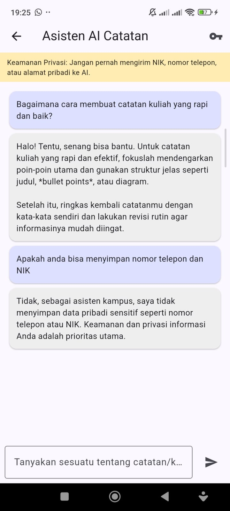
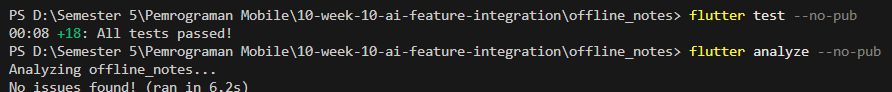

# Sistem Prompt
System prompt yang digunakan pada `AiService` untuk menetapkan persona, batas panjang respons, serta aturan keamanan privasi:

```text
Kamu asisten kampus dan pencatatan yang ramah, jawab dalam Bahasa Indonesia dengan ringkas dan jelas (maksimal 3 kalimat). Jangan pernah meminta atau menampilkan data sensitif seperti NIK, nomor telepon, atau alamat rumah.
```

# User Prompt & Output Awal AI



# Hasil Flutter Test dan Analyze



# Tabel Risiko dan Mitigasi

| Risiko | Mitigasi |
| --- | --- |
| **Bocor data pengguna** | Tidak pernah mengirim data sensitif (NIK, nomor telepon, alamat) ke AI API, menampilkan banner peringatan privasi di ruang chat, serta menyematkan larangan data sensitif pada *System Prompt*. |
| **Kunci API terekspos** | Tidak menyimpan API Key di kode sumber (*hardcode*); API Key disimpan secara lokal menggunakan `flutter_secure_storage`. |
| **Biaya melonjak / Rate limit** | Membatasi panjang respons AI melalui *System Prompt* (maksimal 3 kalimat), mencegah pengiriman pesan berulang saat status masih *loading*, dan mengutamakan penyimpanan lokal (SQLite) untuk data catatan. |
| **API error / Layanan down** | Menangkap eksepsi dengan blok `try-catch` dan menampilkan *AlertDialog* ramah ("Layanan AI Sibuk — Coba lagi nanti atau gunakan mode offline") tanpa membuat aplikasi *crash*. |
| **Respons tidak relevan** | Menerapkan *System Prompt* yang spesifik sebagai asisten kampus dan pencatatan berbahasa Indonesia. |


# Refleksi 
1. Fitur AI mana yang Anda integrasikan dan mengapa?

Fitur yang diintegrasikan adalah Chat Interface berbasis LLM (Google Gemini API) karena sangat relevan untuk membantu pengguna aplikasi Offline Notes dalam merangkum ide dan mengeksplorasi materi catatan secara interaktif.

2. Bagaimana Anda melindungi privasi pengguna saat menggunakan AI API?

Privasi pengguna dilindungi melalui penerapan prinsip privacy by design, yaitu dengan tidak mengirimkan data sensitif (seperti NIK, nomor telepon, atau alamat) ke cloud API. Hal ini diperkuat melalui aturan pembatasan pada System Prompt, penyediaan banner peringatan privasi pada antarmuka chat, serta enkripsi penyimpanan API Key secara lokal menggunakan flutter_secure_storage

3. Fallback apa yang Anda sediakan jika layanan AI error?

Jika terjadi gangguan jaringan atau kuota habis, aplikasi menangkap eksepsi via try-catch dan memunculkan AlertDialog interaktif "Layanan AI Sibuk" yang menyediakan opsi pengaturan ulang kunci, sementara fitur catatan lokal (offline) tetap berjalan normal.

4. Satu hal apa yang Anda pelajari tentang UX fitur AI di mobile?

Pengembangan fitur AI menuntut adanya umpan balik visual yang transparan seperti indikator loading, efek streaming response, dan penonaktifan tombol interaksi untuk mengurangi ketidakpastian pengguna saat menunggu proses komputasi awan yang asinkron.