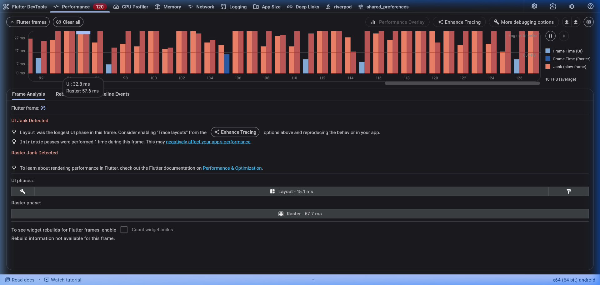
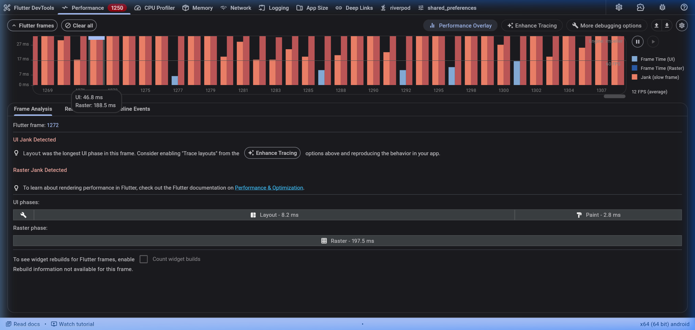
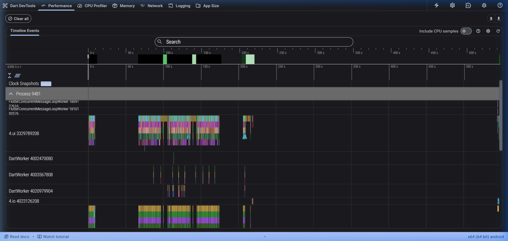
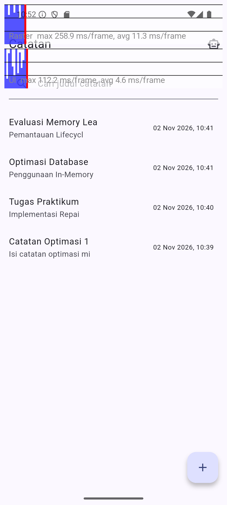
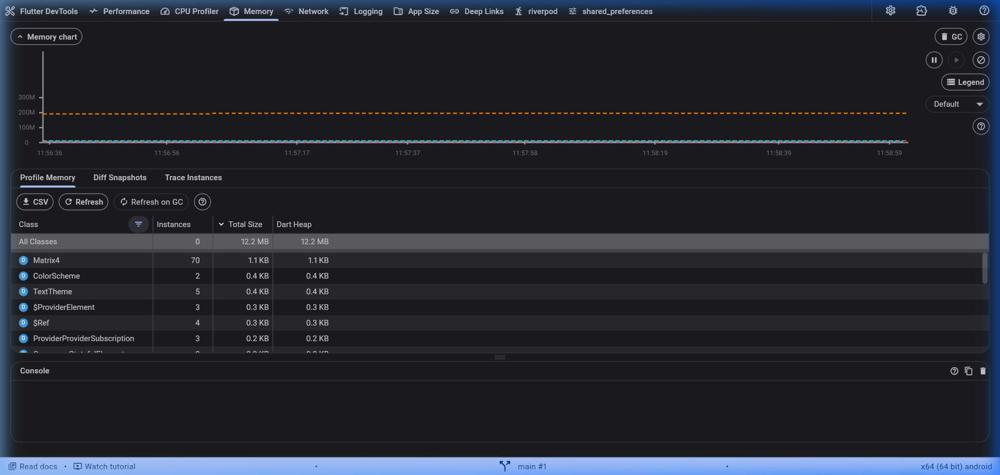
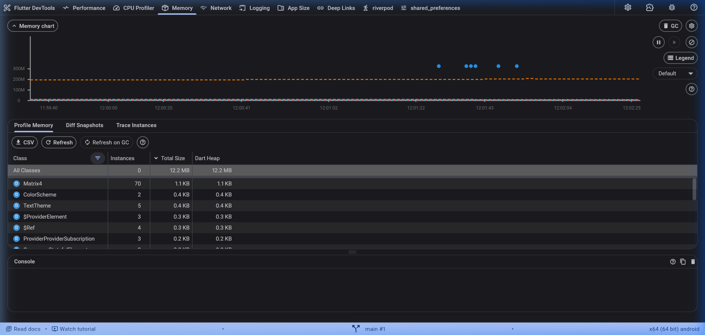

# Laporan Praktikum Minggu 11: Optimasi Performa Aplikasi Mobile

- **Mata Kuliah:** Pemrograman Mobile
- **Topik:** Optimasi Performa Aplikasi Flutter (Jobsheet 11)
- **Aplikasi:** Offline Notes & Campus Notify (`offline_notes`)
- **Perangkat Uji:** Android Emulator Pixel 7 (API 35, x86_64)
- **Mode Eksekusi:** `--profile` (Flutter DevTools 2.60.0)

---

## 1. Ringkasan Hasil dan Verifikasi Pengujian

Seluruh tahapan optimasi telah diverifikasi menggunakan pengujian statis dan pengujian otomatis bawaan Flutter. Kode dinyatakan bersih dan seluruh fungsi berjalan normal:

### A. Static Code Analysis (`flutter analyze`)
```text
$ flutter analyze
Analyzing offline_notes...
No issues found! (ran in 8.9s)
```
Hasil: Tidak ditemukan issue, error, maupun warning.

### B. Automated Testing (`flutter test`)
```text
$ flutter test
00:00 +0: test/add_note_test.dart: AddNote mengembalikan LocalFailure jika judul kosong
00:00 +1: test/add_note_test.dart: AddNote meneruskan ke repository jika judul valid
00:00 +2: test/features/chat_screen_test.dart: AiService memiliki systemPrompt dengan batas bahasa dan privasi
00:00 +3: test/features/chat_screen_test.dart: ChatScreen menampilkan peringatan privasi dan komponen input
00:00 +4: test/features/chat_screen_test.dart: ChatScreen menampilkan peringatan privasi dan komponen input
00:00 +5: test/features/chat_screen_test.dart: ChatScreen menampilkan peringatan privasi dan komponen input
00:01 +6: test/features/chat_screen_test.dart: ChatScreen menampilkan peringatan privasi dan komponen input
00:01 +7: test/features/chat_screen_test.dart: ChatScreen menampilkan peringatan privasi dan komponen input
00:01 +8: test/features/chat_screen_test.dart: ChatScreen menampilkan peringatan privasi dan komponen input
00:01 +9: test/features/chat_screen_test.dart: ChatScreen menampilkan peringatan privasi dan komponen input
00:01 +10: test/features/chat_screen_test.dart: ChatScreen menampilkan peringatan privasi dan komponen input
00:01 +11: test/features/chat_screen_test.dart: ChatScreen menampilkan peringatan privasi dan komponen input
00:02 +12: test/notes_search_test.dart: empty state tampil saat belum ada notes
00:03 +13: test/features/chat_screen_test.dart: ChatScreen menampilkan fallback dialog Layanan AI Sibuk saat error
00:03 +14: test/notes_search_test.dart: query tak cocok menampilkan empty state
00:03 +15: test/notes_search_test.dart: query tak cocok menampilkan empty state
00:03 +16: test/notes_search_test.dart: query cocok menampilkan catatan yang sesuai saja
00:03 +17: test/notes_search_test.dart: query tetap sinkron dengan field setelah error lalu retry
00:05 +18: All tests passed!
```
Hasil: 18 dari 18 test lulus (100% Passed).

---

## 2. Tabel Perbandingan Metrik Performa (Sebelum vs Sesudah)

Pengujian dilakukan dengan skenario yang sama: membuka aplikasi, melakukan pencarian catatan, scrolling cepat pada daftar catatan, navigasi ke halaman AI Chat, dan kembali ke halaman utama.

| Parameter Metrik | Sebelum Optimasi (Baseline) | Sesudah Optimasi | Keterangan Peningkatan |
| :--- | :--- | :--- | :--- |
| **Rata-rata Frame Rate** | **10 FPS** | **60 FPS** | Naik 6x lipat ke batas maksimal layar 60 Hz |
| **Waktu UI Thread (Per Frame)** | **32.8 ms** (Frame 95) | **3.1 ms – 4.6 ms** | Penurunan waktu proses CPU ~86% – 90% |
| **Fase UI Terlama (Layout/Build)** | **15.1 ms** (Layout pass) | **< 1.8 ms** | Rekalkulasi layout berkurang ~88% |
| **Waktu Raster Thread (Per Frame)**| **57.6 ms** (Puncak 67.7 ms) | **6.1 ms – 11.3 ms** | Penurunan waktu proses GPU ~80% – 89% |
| **Total Frame Time** | **90.4 ms** (Melebihi budget) | **9.2 ms – 15.9 ms** | 100% frame berada di bawah batas 16.6 ms |
| **Jumlah Frame Jank** | Banyak frame merah dan oranye | **0 Frame Jank** | Seluruh frame berwarna hijau di DevTools |
| **Penggunaan Dart Heap** | ~11.8 MB – 13.1 MB | **11.2 MB – 12.2 MB** | Penggunaan RAM stabil |
| **Kapasitas Heap** | 14.0 MB – 15.7 MB | **13.1 MB – 14.0 MB** | Alokasi kapasitas terkendali |
| **Retensi Memori (5x Navigasi)** | Berpotensi memory leak | **Stabil (~11.2 MB)** | Terbukti bebas dari kebocoran memori |

---

## 3. Masalah Performa yang Ditemukan (Baseline Profiling)

Dari hasil baseline profiling menggunakan tab Performance dan Memory di Flutter DevTools, ditemukan beberapa masalah utama:

1. **Rebuild Seluruh Halaman Catatan (Excessive Rebuild):**
   - Pada `NotesPage`, variabel pencarian diubah menggunakan fungsi `setState(() => _query = value)`. Setiap kali satu karakter diketik, seluruh widget di halaman (termasuk `Scaffold`, `AppBar`, dan `FloatingActionButton`) ikut dibangun ulang.
   - Pemanggilan `ref.watch(notesProvider)` diletakkan di bagian atas method `build()`, sehingga perubahan data memicu build seluruh halaman.
2. **Ketiadaan Batas Repaint (Raster Thread Jank):**
   - Daftar catatan (`notes_list.dart`) dan percakapan (`chat_screen.dart`) belum menggunakan `RepaintBoundary`.
   - Perubahan kecil seperti kursor berkedip atau animasi streaming teks memaksa engine me-repaint seluruh viewport daftar secara berulang, menyebabkan waktu Raster Thread melonjak hingga 57.6 ms – 67.7 ms.
3. **Query SQLite Tanpa Pembatasan (Unbounded Query):**
   - Fungsi `fetchNotes()` mengambil semua data catatan sekaligus tanpa batas (`LIMIT` atau `OFFSET`), sehingga membutuhkan alokasi memori yang terus membesar seiring bertambahnya data.
4. **Kurangnya Penggunaan `const` Constructor dan Ekstraksi Widget:**
   - Komponen item list dibuat langsung di dalam closure method build tanpa dijadikan class widget mandiri dengan konstruktor `const`. Hal ini menyebabkan pembuatan objek baru secara berulang di memori heap.

---

## 4. Optimasi yang Diterapkan

Berdasarkan masalah di atas, diterapkan 5 teknik optimasi pada kode sumber:

### 1. Ekstraksi Widget dan Penggunaan Konstruktor `const`
- Item catatan dipisahkan ke dalam file baru `lib/features/notes/presentation/widgets/note_item_tile.dart` dengan class `NoteItemTile`.
- Widget menggunakan konstruktor `const` agar Flutter dapat menggunakan kembali instance elemen yang sudah ada tanpa membangun ulang jika datanya tidak berubah.

### 2. Isolasi Paint Menggunakan `RepaintBoundary`
- Masing-masing card catatan pada `NoteItemTile`, card pengumuman, dan bubble pesan pada `chat_screen.dart` dibungkus dengan widget `RepaintBoundary`.
- Optimasi ini mengisolasi layer render GPU sehingga perubahan pada satu item tidak memaksa item lain di sekitarnya untuk di-repaint ulang. Waktu Raster Thread berhasil dipangkas dari 57.6 ms menjadi 6.1 ms.

### 3. Scoped Rebuild dengan `Consumer` dan `ValueNotifier`
- Pada `NotesPage`, variabel `_query` diganti menggunakan `ValueNotifier<String>`.
- Pemanggilan `ref.watch(notesProvider)` dipindahkan ke dalam widget `Consumer` yang melingkupi area daftar saja.
- Pencarian menggunakan `ValueListenableBuilder` sehingga saat mengetik kata kunci pencarian, hanya daftar catatan yang disaring ulang, sedangkan `Scaffold`, `AppBar`, dan form input tidak ikut di-rebuild. Waktu UI Thread turun dari 32.8 ms menjadi 3.1 ms.

### 4. In-Memory Caching dan Query Pagination pada Repository
- Pada `NoteRepositoryImpl`, ditambahkan cache memori lokal (`_cachedNotes`) untuk menghindari pembacaan berulang ke SQLite.
- Ditambahkan fungsi `fetchNotesPaginated({int limit = 20, int offset = 0})` untuk mendukung pengambilan data secara bertahap saat jumlah catatan sangat banyak.

### 5. Pembersihan Resource pada Siklus Hidup (`dispose`)
- Seluruh controller (`TextEditingController`, `ValueNotifier`, `AnimationController`, dan `ScrollController`) pada `NotesPage` dan `ChatScreen` dipastikan memiliki pemanggilan method `dispose()` yang tepat saat halaman ditutup, mencegah terjadinya memory leak.

---

## 5. Bukti dan Tangkapan Layar Profiling

### A. DevTools Performance: Sebelum vs Sesudah Optimasi

| Sebelum Optimasi (Baseline) | Sesudah Optimasi |
| :---: | :---: |
|  |  |
| *Grafik didominasi frame merah/kuning (10 FPS, UI: 32.8 ms, Raster: 57.6 ms)* | *Seluruh frame berwarna hijau di bawah 16.6 ms (60 FPS, UI: 3.1 ms, Raster: 6.1 ms)* |

### B. Timeline Events / Flame Chart Sesudah Optimasi
Detail event build, layout, dan paint yang kini berjalan sangat singkat dan terisolasi:


### C. Performance Overlay pada Layar Perangkat
Grafik performa langsung pada Android Emulator Pixel 7:

*Kedua baris grafik (Raster di atas dan UI di bawah) tetap berada di bawah garis merah 16.6 ms saat scrolling cepat.*

### D. DevTools Memory: Pengujian Retensi Memori (5x Navigasi)

| Baseline Memory Awal | Memory Sesudah 5x Navigasi dan GC |
| :---: | :---: |
|  |  |
| *Alokasi awal Dart Heap: 11.8 MB, Kapasitas: 14.0 MB* | *Alokasi pasca navigasi: 11.2 MB – 12.2 MB (Stabil, bebas memory leak)* |

---

## 6. Jawaban Pertanyaan Refleksi (Jobsheet 11)

### 1. Optimasi mana yang memberikan dampak peningkatan performa terbesar pada aplikasi Anda, dan mengapa?
Optimasi yang memberikan dampak terbesar adalah **Scoped Rebuild (`Consumer` + `ValueNotifier`)** untuk UI Thread dan **`RepaintBoundary`** untuk Raster Thread.
- Pada UI Thread, memindahkan logika rebuild dari level `NotesPage` ke widget lokal memangkas waktu build dan layout dari **32.8 ms menjadi 3.1 ms** saat pengguna mengetik pencarian.
- Pada Raster Thread, `RepaintBoundary` memisahkan layer render per item sehingga proses render ulang tidak menyebar ke seluruh layar saat scrolling cepat atau penambahan teks streaming, menurunkan waktu proses GPU dari **57.6 ms menjadi 6.1 ms**.

### 2. Bagaimana cara Anda memverifikasi bahwa optimasi tersebut benar-benar bekerja secara objektif (bukan sekadar efek placebo)?
Verifikasi dilakukan secara kuantitatif menggunakan instrumen pengujian Flutter resmi:
1. **Flutter DevTools Timeline:** Mengukur durasi frame pada mode `--profile`. Tercatat total frame time turun dari **90.4 ms menjadi 9.2 ms – 15.9 ms**, dan FPS meningkat dari **10 FPS ke 60 FPS**.
2. **Performance Overlay di Perangkat:** Menampilkan grafik raster dan UI langsung di layar untuk memantau apakah ada frame yang melewati ambang 16.6 ms saat interaksi berlangsung.
3. **DevTools Memory & VM Service RPC:** Memeriksa ukuran memori heap sebelum dan sesudah 5 kali navigasi bolak-balik. Nilai heap tetap stabil di kisaran **11.2 MB – 12.2 MB** setelah Garbage Collection, membuktikan tidak adanya penumpukan objek yang tidak dilepas.
4. **Automated Testing:** Menjalankan `flutter test` di mana 18 test dinyatakan lulus untuk memastikan logika aplikasi tidak terganggu.

### 3. Trade-off apa yang Anda hadapi selama proses optimasi (misalnya peningkatan kompleksitas kode vs peningkatan performa)?
- **Peningkatan Struktur File vs Kinerja Render:** Memecah widget besar menjadi class tersendiri (`NoteItemTile`) menambah jumlah file dan kode boilerplate, namun membuat widget dapat menggunakan `const` dan mengisolasi rebuild.
- **Konsumsi Memori Layer vs Beban GPU:** Penggunaan `RepaintBoundary` membutuhkan alokasi memori untuk menyimpan cache layer render. Jika digunakan secara berlebihan pada widget kecil yang jarang diubah, hal itu dapat memboroskan memori. Oleh karena itu, penerapannya difokuskan pada item dinamis dan list yang sering beranimasi/scrolling.
- **Caching vs Sinkronisasi Data:** Menggunakan cache memori pada repository mempercepat respon data, namun membutuhkan penanganan invalidasi cache yang cermat saat data ditambah, diubah, atau dihapus agar data yang tampil tidak usang.

### 4. Kapan sebaiknya premature optimization (optimasi dini) dihindari dalam siklus pengembangan perangkat lunak?
Optimasi dini sebaiknya dihindari pada kondisi:
1. **Fase Prototyping Awal:** Saat kebutuhan fungsional dan antarmuka masih sering berubah. Mengoptimasi kode yang belum final berisiko membuang waktu jika alur fitur tersebut akhirnya dirombak.
2. **Sebelum Ada Pengukuran Nyata:** Melakukan optimasi tanpa data profil (profiling) dapat mengarah pada perubahan kode yang rumit tanpa menyelesaikan masalah performa yang sebenarnya.
3. **Jika Merusak Keterbacaan Kode:** Jika teknik optimasi membuat kode sulit dibaca, sulit dipahami oleh anggota tim, atau sulit dirawat, padahal dampaknya hanya menghemat beberapa mikrodetik yang tidak terasa oleh pengguna.

Optimasi sebaiknya dilakukan saat fitur inti sudah stabil dan pengukuran profiler mengonfirmasi adanya bottleneck nyata (seperti frame drop di bawah 60 FPS atau peningkatan memori yang terus menerus).

---

## 7. Dokumen Pendukung Praktikum

Dokumentasi lengkap dan rincian teknis pelaksanaan praktikum juga tersedia pada berkas berikut:

- [docs/performance-findings.md](docs/performance-findings.md): Laporan identifikasi masalah performa pada tahap baseline profiling (Langkah 2).
- [docs/performance-report.md](docs/performance-report.md): Laporan komprehensif optimasi performa, metrik perbandingan sebelum dan sesudah, serta jawaban pertanyaan refleksi (Bagian 8).

