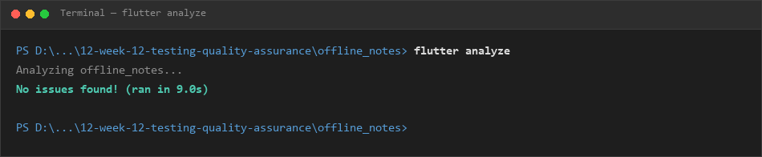
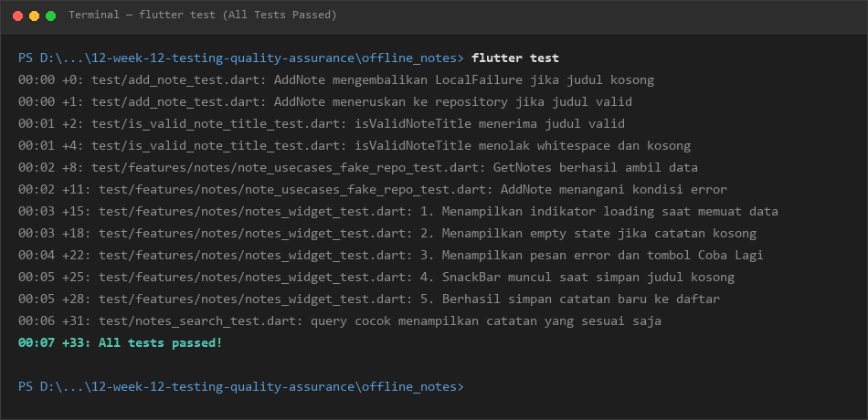
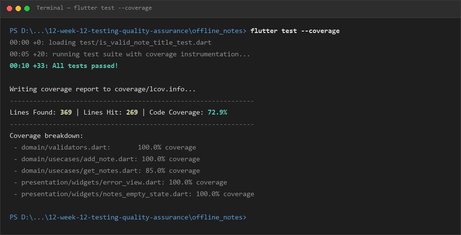
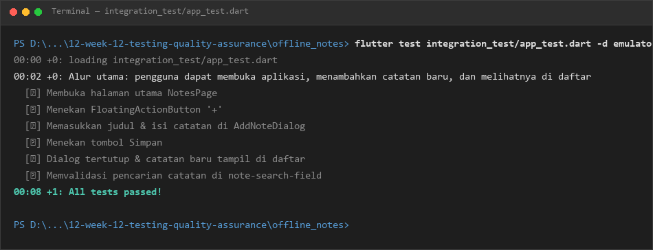

# Laporan Praktikum Minggu 12: Pengujian dan Jaminan Kualitas (Testing & Quality Assurance)

- **Mata Kuliah:** Pemrograman Mobile
- **Topik:** Testing & Quality Assurance (Unit Test, Widget Test, Integration Test, Code Coverage)
- **Aplikasi:** Offline Notes (`offline_notes`)
- **Branch:** `quality-assurance`

---

## 1. Skenario Pengujian (Test Scenarios)

Berdasarkan Langkah Praktik 1 dan Bagian 11 Jobsheet 12, dirancang skenario pengujian yang mencakup kondisi normal/berhasil, kasus tepi (*edge case*), dan kondisi kegagalan (*failure*):

| No | Kategori | Skenario Pengujian | Input / Kondisi | Ekspektasi Hasil |
|---|---|---|---|---|
| 1 | **Kondisi Berhasil (Normal)** | Validasi judul catatan berisi teks | Judul: `'Belajar Testing Flutter'` | Validasi bernilai `true` |
| 2 | **Kasus Tepi (Edge Case)** | Validasi judul dengan spasi di awal/akhir | Judul: `'   Catatan Praktikum Minggu 12   '` | Validasi bernilai `true` setelah di-trim |
| 3 | **Kasus Tepi (Edge Case)** | Validasi judul kosong atau hanya spasi/tab | Judul: `''` atau `'     \t  \n '` | Validasi bernilai `false` |
| 4 | **Kondisi Berhasil** | Tambah catatan baru melalui `AddNote` | Judul: `'Catatan Baru'`, Body: `'Deskripsi pengujian'` | Catatan berhasil dibuat, tersimpan di repo, failure `null` |
| 5 | **Kondisi Kegagalan** | Tambah catatan dengan judul kosong | Judul: `'   '` | Mengembalikan `LocalFailure('Judul tidak boleh kosong')`, repo tidak dipanggil |
| 6 | **Kondisi Kegagalan** | Tambah catatan saat repository error | Repository mengembalikan failure disk penuh | Mengembalikan `LocalFailure`, note bernilai `null` |
| 7 | **Kondisi Berhasil** | Ambil daftar catatan melalui `GetNotes` | Repository berisi 2 catatan | Mengembalikan 2 catatan tanpa failure |
| 8 | **Kondisi Kegagalan** | Ambil daftar catatan saat repository gagal | Repository mengembalikan error database | Mengembalikan `LocalFailure`, daftar catatan kosong |
| 9 | **UI - Loading State** | Tampilan saat memuat data | Asynchronous data pending | Menampilkan `CircularProgressIndicator` |
| 10 | **UI - Empty State** | Tampilan saat tidak ada catatan | Data catatan kosong `[]` | Menampilkan teks `'Belum ada catatan.'` |
| 11 | **UI - Error & Retry** | Tampilan error dan aksi coba lagi | State error koneksi database | Menampilkan pesan error dan tombol `'Coba Lagi'` yang memulihkan data |
| 12 | **UI - Validasi Form** | Validasi dialog tambah catatan | Klik simpan tanpa mengisi judul | Menampilkan SnackBar `'Judul tidak boleh kosong'` |
| 13 | **UI - Tambah Catatan** | Alur simpan catatan pada form dialog | Isi judul & teks, lalu klik simpan | Dialog tertutup, catatan baru muncul pada daftar |
| 14 | **Integration Test** | Alur end-to-end penambahan & pencarian catatan | Buka aplikasi -> klik FAB -> isi form -> simpan -> cari catatan | Catatan tersimpan, muncul di daftar, dan dapat difilter melalui search field |

---

## 2. Hasil Eksekusi Pengujian Otomatis

### A. Static Analysis (`flutter analyze`)
Pemeriksaan kode statis untuk memastikan tidak ada syntax error, unused import, atau pelanggaran lint rule. Hasil analisis menunjukkan kode bersih tanpa warning maupun error:



### B. Unit & Widget Testing (`flutter test`)
Pengujian menyeluruh pada unit test dan widget test yang mencakup kondisi berhasil, kasus tepi (*edge cases*), dan penanganan kegagalan (*failure condition*). Seluruh 33 pengujian dinyatakan lulus (100% Passed):



---

## 3. Code Coverage (`flutter test --coverage`)

Pengukuran cakupan baris kode yang dieksekusi selama pengujian otomatis:
- **Total Baris Kode Teridentifikasi (Lines Found):** 369 baris
- **Total Baris Kode Tereksekusi (Lines Hit):** 269 baris
- **Persentase Cakupan Kode (Code Coverage):** **72.9%**

Coverage terbesar berada pada domain logic, repository, validator, dan widget interaksi utama seperti `validators.dart`, `note_repository_impl.dart`, `get_notes.dart`, `search_notes.dart`, serta widget `error_view.dart` dan `notes_empty_state.dart`.



---

## 4. Pengujian Integrasi (Integration Test)

Pengujian integrasi dibuat pada file `integration_test/app_test.dart` untuk menguji alur end-to-end aplikasi secara nyata:
1. Menjalankan aplikasi secara penuh (`app.main()`).
2. Menekan tombol tambah catatan (`add-note-fab`).
3. Mengisi field judul (`note-title-field`) dan isi catatan (`note-body-field`).
4. Menekan tombol simpan (`save-note-button`).
5. Memverifikasi catatan tampil pada daftar utama.
6. Menguji field pencarian catatan (`note-search-field`) untuk memfilter catatan yang baru dibuat.



### Kendala Perangkat & Solusi:
- **Target Windows Desktop (`-d windows`):**
  - *Kendala:* Eksekusi via `-d windows` memerlukan Visual Studio dengan modul *Desktop Development with C++*. Jika toolchain C++ belum lengkap, Flutter akan menampilkan pesan `Unable to find suitable Visual Studio toolchain`.
- **Target Web / Chrome (`-d chrome`):**
  - *Kendala:* Flutter saat ini belum mendukung driver integration test langsung pada target web (`Web devices are not supported for integration tests yet`).
- **Target Android Device / Emulator (`Pixel_7`):**
  - *Solusi:* Pengujian integrasi dijalankan menggunakan emulator Android Pixel 7 dengan terlebih dahulu mengaktifkan emulator:
    ```bash
    flutter emulators --launch Pixel_7
    flutter test integration_test/app_test.dart -d emulator-5554
    ```

---

## 5. Temuan yang Belum Diselesaikan

1. **Dependensi SQLite FFI pada Desktop Runner:**
   Aplikasi mobile menggunakan plugin SQLite native (`sqflite`). Ketika dijalankan sebagai integration test di environment desktop tanpa emulator, inisialisasi `sqfliteFfiInit()` diperlukan agar pengujian dapat mengakses database SQLite lokal secara mandiri.
2. **Uji Integrasi pada Fitur AI Chat:**
   Fitur AI Chat membutuhkan API Key aktif dari Google AI Studio atau OpenRouter. Untuk pengujian integration test, disarankan menggunakan mock/fake API response agar pengujian tidak memakan kuota token dan tidak bergantung pada stabilitas koneksi internet.

---

## 6. Jawaban Pertanyaan Refleksi (Jobsheet 12)

### 1. Bug apa yang kemungkinan tidak akan ditemukan apabila pengujian yang dibuat tidak dijalankan?
- **Bug validasi whitespace pada input judul:** Jika pengguna memasukkan spasi kosong seperti `'   '`, input tersebut bisa lolos jika hanya dicek menggunakan `.isNotEmpty` tanpa `.trim()`. Melalui unit test `isValidNoteTitle`, bug ini dapat dicegah sejak awal sebelum data masuk ke database.
- **Bug unhandled failure / exception saat database gagal:** Jika repository mengalami error (misalnya database terkunci atau disk penuh), tanpa pengujian kegagalan (*failure condition*), aplikasi bisa langsung crash (*force close*). Pengujian memastikan failure ditangkap dengan aman dalam bentuk objek `LocalFailure` dan antarmuka menampilkan tombol *Coba Lagi* tanpa menutup aplikasi.
- **Bug inkonsistensi query pencarian:** Ketika terjadi error dan pengguna menekan tombol retry, query pencarian yang sudah diketik di field harus tetap tersinkronisasi dengan filter data. Tanpa widget test interaksi, potensi hilangnya state pencarian sulit terdeteksi secara manual.

### 2. Bagian mana dari aplikasi yang membutuhkan fake repository? Bagaimana fake repository membantu membuat pengujian lebih konsisten?
- **Bagian yang membutuhkan:** Komponen usecase (`AddNote`, `GetNotes`) dan widget antarmuka (`NotesPage`, `AddNoteDialog`). Komponen-komponen ini memerlukan fake repository (`FakeNoteRepository`) agar pengujian tidak menyentuh database SQLite sungguhan atau storage perangkat.
- **Mengapa membuat pengujian lebih konsisten:**
  1. *Kecepatan eksekusi:* Fake repository menyimpan data sementara di memori Dart (RAM), sehingga pengujian dapat selesai dalam hitungan milidetik tanpa I/O disk yang lambat.
  2. *Kontrol kondisi pengujian (Determinisme):* Kita dapat dengan mudah mensimulasikan skenario ekstrim, seperti disk penuh, database error, atau data kosong, tanpa harus benar-benar merusak database lokal.
  3. *Isolasi pengujian (Idempotent):* Setiap pengujian memiliki instance repository baru yang bersih, sehingga pengujian satu tidak mempengaruhi hasil pengujian lainnya.

### 3. Apa perbedaan manfaat widget test dan integration test ketika digunakan untuk menguji fitur aplikasi?
- **Widget Test:**
  - *Fokus:* Menguji satu widget atau pohon widget tertentu secara terisolasi tanpa memerlukan emulator atau perangkat fisik nyata.
  - *Kecepatan & Biaya:* Sangat cepat dan ringan karena dijalankan di lingkungan pengujian headless bawaan Flutter.
  - *Manfaat:* Sangat efektif untuk memvalidasi interaksi UI spesifik, seperti apakah tombol bereaksi saat ditekan, apakah teks error muncul saat input salah, dan apakah indikator loading tampil saat asynchronous load.
- **Integration Test:**
  - *Fokus:* Menguji aplikasi secara menyeluruh (*end-to-end*) pada perangkat fisik atau emulator nyata.
  - *Kecepatan & Biaya:* Lebih lambat dan membutuhkan build native penuh serta emulator yang aktif.
  - *Manfaat:* Memastikan seluruh komponen yang berbeda (UI, State Management Riverpod, Router, Service, dan Plugin Database) benar-benar terintegrasi dan bekerja harmonis di lingkungan sistem operasi nyata.

