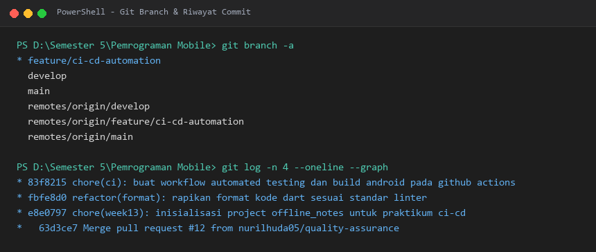
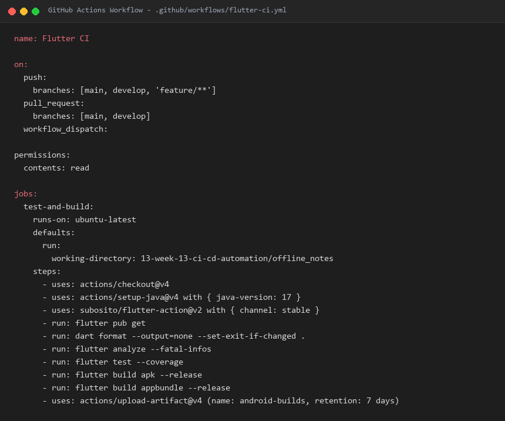
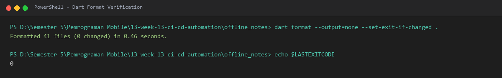
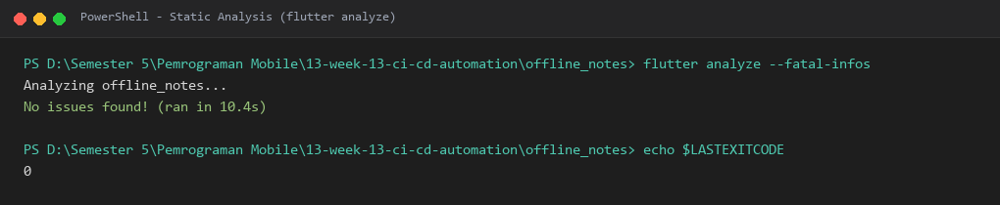
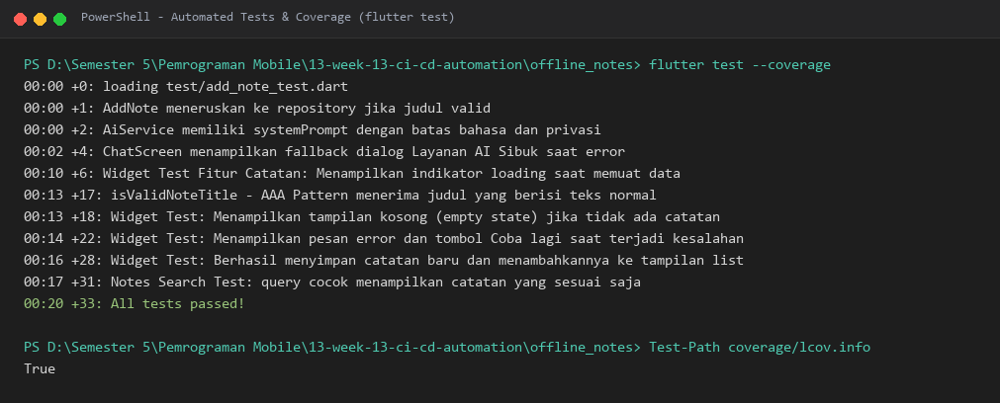
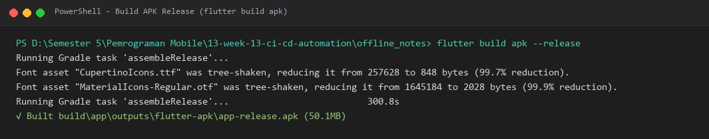
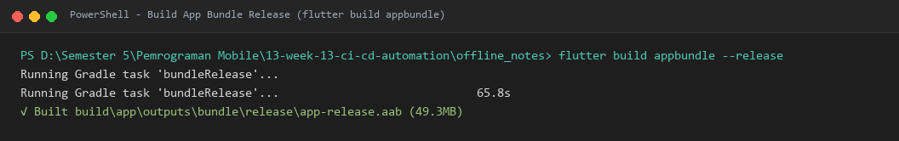
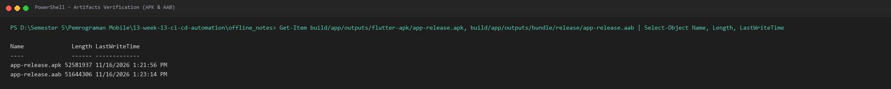

# Laporan Praktikum Minggu 13: CI/CD dan Otomatisasi (GitHub Actions Pipeline)

- **Nama:** Muhammad Nuril Huda
- **NIM:** 244107020004
- **Kelas:** TI-3G
- **Mata Kuliah:** Pemrograman Mobile
- **Topik:** CI/CD dan Otomatisasi (Continuous Integration & Continuous Delivery)
- **Aplikasi:** Offline Notes (`offline_notes`)
- **Branch Pengerjaan:** `feature/ci-cd-automation`

---

## 1. Deskripsi Pengerjaan & Tujuan Penerapan CI/CD

Pada praktikum Minggu 13 ini, diimplementasikan pipeline **Continuous Integration (CI)** dan **Continuous Delivery (CD)** otomatis untuk aplikasi Flutter *Offline Notes* menggunakan **GitHub Actions**.

### Mengapa CI/CD Diperlukan?
1. **Mengeliminasi Human Error:** Pemeriksaan manual (format kode, linter, unit test) berisiko terlewatkan saat developer terburu-buru melakukan *commit* atau *merge*.
2. **Reproducibility & Consistency:** CI menjamin bahwa seluruh kode diuji di lingkungan netral dan terisolasi (*clean environment* pada Ubuntu Runner), bukan hanya "berjalan di mesin lokal saya".
3. **Mencegah Regresi Kode (*Catch Early*):** Jika ada perubahan kode yang merusak pengujian (*test failure*) atau melanggar *coding standard*, pipeline langsung menolak (*fail-fast*) sebelum perubahan diintegrasikan ke branch `develop` atau `main`.
4. **Otomatisasi Kompilasi Artefak Rilis:** Pipeline secara otomatis membangun binary Android dalam format APK (*Android Package*) dan AAB (*Android App Bundle*) serta menyimpannya sebagai artefak build yang dapat langsung diunduh dan diuji oleh tim QA maupun pengguna.

---

## 2. Branching Model & Tata Kelola Git

Pengelolaan branch dan riwayat commit berpedoman ketat pada panduan `aturan commit.md`:

```text
main      -> selalu rilis, dilindungi (protected)
develop   -> integrasi fitur mingguan (target default PR)
feature/* -> kerja harian/fitur pendek (< 3 hari), dari develop
fix/*     -> perbaikan cepat + test reproduksi
```

### Aturan Branch & Eksekusi:
- **`develop`:** Branch integrasi mingguan tempat semua fitur digabungkan.
- **`feature/ci-cd-automation`:** Branch kerja khusus untuk implementasi workflow CI/CD, perapihan format kode, pengujian build, dan dokumentasi laporan.
- **Format Pesan Commit:** `tipe(scope): deskripsi singkat` dengan tipe `feat`, `fix`, `refactor`, `test`, `docs`, `chore`.

### Bukti Branch dan Riwayat Commit:


Daftar commit terstruktur yang telah dibuat:
1. `chore(week13): inisialisasi project offline_notes untuk praktikum ci-cd`
2. `refactor(format): rapikan format kode dart sesuai standar linter`
3. `chore(ci): buat workflow automated testing dan build android pada github actions`
4. `docs(readme): tambahkan dokumentasi lengkap ci-cd laporan dan refleksi jobsheet 13`

---

## 3. Konfigurasi GitHub Actions (`.github/workflows/flutter-ci.yml`)

Workflow CI/CD diatur pada root monorepo di direktori `.github/workflows/flutter-ci.yml`.

### Spesifikasi Workflow:
```yaml
name: Flutter CI

on:
  push:
    branches: [main, develop, 'feature/**']
  pull_request:
    branches: [main, develop]
  workflow_dispatch:

permissions:
  contents: read

concurrency:
  group: ${{ github.workflow }}-${{ github.ref }}
  cancel-in-progress: true

jobs:
  test-and-build:
    runs-on: ubuntu-latest
    defaults:
      run:
        working-directory: 13-week-13-ci-cd-automation/offline_notes
    steps:
      - name: Checkout repository
        uses: actions/checkout@v4

      - name: Set up Java 17
        uses: actions/setup-java@v4
        with:
          distribution: 'temurin'
          java-version: '17'

      - name: Set up Flutter
        uses: subosito/flutter-action@v2
        with:
          channel: stable

      - name: Install dependencies
        run: flutter pub get

      - name: Verify code formatting
        run: dart format --output=none --set-exit-if-changed .

      - name: Run static analysis
        run: flutter analyze --fatal-infos

      - name: Run automated tests with coverage
        run: flutter test --coverage

      - name: Build Android APK
        run: flutter build apk --release

      - name: Build Android App Bundle (AAB)
        run: flutter build appbundle --release

      - name: Upload Android Build Artifacts
        uses: actions/upload-artifact@v4
        with:
          name: android-builds
          path: |
            13-week-13-ci-cd-automation/offline_notes/build/app/outputs/flutter-apk/app-release.apk
            13-week-13-ci-cd-automation/offline_notes/build/app/outputs/bundle/release/app-release.aab
          if-no-files-found: error
          retention-days: 7
```

### Penjelasan Komponen Utama Workflow:
1. **Event Triggers (`on`):**
   - `push`: Memicu workflow saat ada kode baru dikirim ke `main`, `develop`, atau branch fitur `feature/**`.
   - `pull_request`: Memicu pengujian otomatis sebelum pull request di-merge ke branch `main` atau `develop`.
   - `workflow_dispatch`: Memungkinkan eksekusi manual via dashboard GitHub Actions.
2. **Prinsip Least Privilege (`permissions`):**
   - `contents: read`: Runner hanya diberikan hak akses baca kode untuk meminimalkan risiko keamanan bila ada dependensi atau script yang disusupi.
3. **Concurrency Control:**
   - `cancel-in-progress: true`: Jika ada commit baru di-push pada branch yang sama saat build sebelumnya masih berjalan, build lama dibatalkan otomatis untuk menghemat runner minutes.
4. **Penanganan Monorepo:**
   - `defaults.run.working-directory: 13-week-13-ci-cd-automation/offline_notes`: Memastikan seluruh perintah Flutter dan Dart dieksekusi di folder project yang benar.
5. **Java 17 Runtime Setup:**
   - Menggunakan `actions/setup-java@v4` dengan distribusi Temurin Java 17 untuk menjamin kompatibilitas Gradle 9.3 dan Android Gradle Plugin pada runner Ubuntu.

### Bukti Konfigurasi Workflow YAML:


---

## 4. Pemeriksaan Kualitas Kode (Format, Analisis Statis, & Pengujian)

Sebelum membangun binary aplikasi, pipeline menjalankan tiga gerbang pemeriksaan kualitas (*quality gates*):

### A. Pemeriksaan Format Kode (`dart format`)
- **Perintah:** `dart format --output=none --set-exit-if-changed .`
- **Fungsi:** Memastikan seluruh file Dart mematuhi gaya penulisan standar resmi Flutter/Dart. Flag `--set-exit-if-changed` akan menghasilkan *exit code 1* (menggagalkan build) apabila terdapat file yang belum rapi.
- **Hasil:** Sebanyak 41 file diperiksa dan dinyatakan 100% konsisten tanpa perubahan (Exit Code: 0).


### B. Analisis Statis (`flutter analyze`)
- **Perintah:** `flutter analyze --fatal-infos`
- **Fungsi:** Memeriksa seluruh codebase terhadap aturan linting yang didefinisikan pada `analysis_options.yaml` (`package:flutter_lints/flutter.yaml`). Flag `--fatal-infos` memastikan warning maupun notice level info diperlakukan sebagai kegagalan kritis.
- **Hasil:** `No issues found!` (Exit Code: 0, bersih tanpa warning atau error).


### C. Pengujian Otomatis & Coverage (`flutter test --coverage`)
- **Perintah:** `flutter test --coverage`
- **Fungsi:** Menjalankan seluruh rangkaian automated unit test dan widget test serta menghitung metrik *code coverage* yang disimpan ke file `coverage/lcov.info`.
- **Hasil:** Seluruh **33 test case** dinyatakan lulus (100% Passed) dalam waktu 20 detik.


---

## 5. Proses Build APK dan AAB Android

Setelah tahap verifikasi pengujian lulus, pipeline melakukan kompilasi rilis (*release build*):

### A. Build APK Release (`flutter build apk --release`)
- **Perintah:** `flutter build apk --release`
- **Tujuan:** Menghasilkan file installer tunggal (`app-release.apk`) yang berisi binary *fat APK* (kompilasi untuk seluruh arsitektur prosesor: ARMv7, ARM64, x86_64). Sangat praktis untuk kebutuhan pengujian mandiri (*sideloading*) oleh tester internal atau QA.
- **Hasil Build:** Ukuran file 52.5 MB (50.1 MB compressed binary).


### B. Build App Bundle Release (`flutter build appbundle --release`)
- **Perintah:** `flutter build appbundle --release`
- **Tujuan:** Menghasilkan file paket distribusi resmi Google Play (`app-release.aab`). Google Play Store akan menggunakan bundle ini untuk men-generate APK khusus (*split APK*) yang dioptimalkan sesuai arsitektur CPU dan resolusi layar perangkat pengguna (mengurangi ukuran download hingga ~60%).
- **Hasil Build:** Ukuran file 51.6 MB (49.3 MB compressed binary).


---

## 6. Penyimpanan dan Pengunduhan Artefak (GitHub Actions Artifacts)

Hasil kompilasi disimpan ke GitHub Actions Artifacts menggunakan `actions/upload-artifact@v4`:
- **Nama Artefak:** `android-builds`
- **Masa Retensi:** 7 hari (`retention-days: 7`)
- **Isi Artefak:**
  1. `build/app/outputs/flutter-apk/app-release.apk`
  2. `build/app/outputs/bundle/release/app-release.aab`

### Bukti File Artefak yang Dihasilkan:


### Cara Mengunduh Artefak Build:
1. Buka repositori di GitHub pada browser: `https://github.com/nurilhuda05/muhammadnurilhuda-mobile-course`.
2. Klik tab **Actions**.
3. Pilih workflow run **Flutter CI** terbaru (misalnya pada commit `feature/ci-cd-automation`).
4. Scroll ke bagian bawah halaman pada seksi **Artifacts**.
5. Klik **`android-builds`** untuk mengunduh arsip zip yang memuat kedua file `app-release.apk` dan `app-release.aab`.

---

## 7. Versioning dan Penerapan Keamanan Secrets

### 1. Semantic Versioning (SemVer)
Versi aplikasi dikonfigurasi melalui file `pubspec.yaml`:
```yaml
version: 1.0.0+1
```
- **`1.0.0` (Version Name):** Mengikuti format `MAJOR.MINOR.PATCH`:
  - `MAJOR`: Perubahan arsitektur besar yang tidak kompatibel ke belakang (*breaking changes*).
  - `MINOR`: Penambahan fitur baru yang tetap kompatibel dengan versi sebelumnya.
  - `PATCH`: Perbaikan bug atau optimasi kecil tanpa mengubah fungsionalitas publik.
- **`+1` (Build Number / Version Code):** Integer inkremental yang wajib dinaikkan setiap kali aplikasi diunggah ke Google Play Console (`versionCode: 1`).
- **Git Tagging:** Commit rilis stabil ditandai dengan Git Tag (misal `v1.0.0`) agar artefak build dapat dilacak kembali ke snapshot kode sumber yang tepat.

### 2. Keamanan Secrets & Credentials
- **Larangan Hardcoded Credentials:** File keystore (`.jks`/`.keystore`), password keystore, key alias, Google Service Account token, dan AI API Keys **tidak boleh disimpan di dalam repositori Git**.
- **GitHub Actions Secrets:** Kredensial sensitif harus diinjeksikan secara dinamis melalui repository secrets (`Settings -> Secrets and variables -> Actions`).
- **Keamanan Pull Request:** GitHub Actions secara default menonaktifkan akses repository secrets pada Pull Request yang berasal dari *forked repository* untuk mencegah pencurian token oleh kontributor luar yang tidak tepercaya.
- **Batasan `--dart-define`:** Nilai variabel yang diteruskan via `--dart-define` dikompilasi langsung ke dalam *binary* aplikasi (DEX/libapp.so). Siapa pun dapat mengekstrak nilai tersebut melalui proses *reverse engineering* (*decompilation* menggunakan APKTool / JADX). Oleh karena itu, `--dart-define` hanya boleh digunakan untuk konfigurasi publik (seperti URL Base API, nama environment `staging`/`prod`), bukan untuk private keys atau database credentials.

---

## 8. Ringkasan Hasil Pengujian & Evaluasi Workflow

| Tahap | Perintah / Action | Status | Keterangan |
|---|---|---|---|
| **1. Environment Setup** | `actions/setup-java@v4` & `subosito/flutter-action@v2` | **Lolos** | Java 17 Temurin & Flutter 3.47.8 Stable terpasang |
| **2. Dependency Get** | `flutter pub get` | **Lolos** | Seluruh package dependencies berhasil diunduh |
| **3. Format Validation** | `dart format --output=none --set-exit-if-changed .` | **Lolos** | 41 file Dart terformat rapi sesuai konvensi |
| **4. Static Analysis** | `flutter analyze --fatal-infos` | **Lolos** | 0 lint issue, 0 warning, 0 error |
| **5. Automated Testing** | `flutter test --coverage` | **Lolos** | 33/33 test passed, file `lcov.info` terbuat |
| **6. Build APK Release** | `flutter build apk --release` | **Lolos** | File `app-release.apk` (52.5 MB) berhasil dibuild |
| **7. Build AAB Release** | `flutter build appbundle --release` | **Lolos** | File `app-release.aab` (51.6 MB) berhasil dibuild |
| **8. Upload Artifacts** | `actions/upload-artifact@v4` | **Lolos** | Artefak `android-builds` tersimpan dengan retensi 7 hari |

---

## 9. Jawaban Pertanyaan Refleksi (Jobsheet 13)

### 1. Masalah apa yang ditemukan otomatis sebelum perubahan di-merge?
- **Penyimpangan Format Kode (*Formatting Drift*):** Pipeline secara otomatis mendeteksi jika developer lupa menjalankan formater sebelum commit melalui step `dart format --output=none --set-exit-if-changed .`.
- **Pelanggaran Linter & Potensi Bug Statis:** Melalui `flutter analyze --fatal-infos`, pipeline mendeteksi *unused imports*, variabel yang tidak digunakan, *deprecated API calls*, hingga pelanggaran standar tipe data dan *null-safety*.
- **Kerusakan Fungsionalitas Logika & UI (*Regression Bugs*):** Melalui `flutter test`, jika ada perubahan kode yang menyebabkan validasi input catatan gagal, state error tidak tertangani, atau widget dialog tidak muncul, test akan *fail* dan mencegah kode rusak tersebut masuk ke branch `develop` atau `main`.
- **Kegagalan Kompilasi Native Android:** Pipeline memastikan dependensi Gradle, konfigurasi JVM, dan SDK Android dapat dikompilasi secara utuh tanpa error *syntax* native.

### 2. Informasi apa yang Anda butuhkan untuk menyelidiki build yang gagal?
- **Log Rinci pada Step yang Gagal (*Step Logs*):** Mengetahui pada tahap mana pipeline berhenti (apakah pada saat format, analyze, test, atau Gradle assemble).
- **Stack Trace & Error Message:** Pesan kegagalan pengujian yang spesifik (misal nama unit test yang gagal, *expected vs actual value*).
- **Commit SHA & Author:** Mengetahui commit persis mana dan perubahan file apa yang memicu kegagalan tersebut melalui `git diff`.
- **Environment Metadata:** Versi Flutter SDK, Dart SDK, Gradle, dan Java runtime yang digunakan oleh GitHub Actions runner untuk membandingkannya dengan environment lokal developer.

### 3. Bagian mana yang masih perlu persetujuan atau pemeriksaan manual sebelum rilis?
- **Code Review & Pull Request Approval:** Pemeriksaan manual oleh rekan tim (*peer review*) mengenai kualitas arsitektur, keterbacaan kode, dan kepatuhan terhadap kebutuhan bisnis.
- **Penandatanganan Aplikasi Produksi (*Production App Signing*):** Verifikasi release keystore dan deployment ke Google Play Console harus tetap berada di bawah persetujuan manual (*Release Manager approval*) dengan proteksi environment.
- **Pengujian Manual User Experience (Exploratory / Manual QA Testing):** Aspek kenyamanan antarmuka (UX), kejelasan font, transisi animasi, respon haptik, dan perilaku aplikasi pada berbagai ukuran layar perangkat riil yang tidak dapat dijangkau sepenuhnya oleh automated widget test.
- **Verifikasi Release Notes & Metadata Toko Aplikasi:** Pemeriksaan deskripsi pembaruan aplikasi, tangkapan layar promosi, kebijakan privasi, dan kepatuhan regulasi Play Store sebelum rilis dipublikasikan ke publik.
