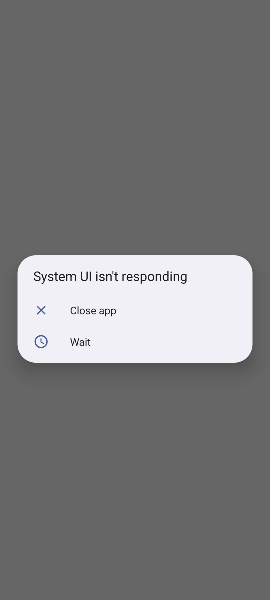
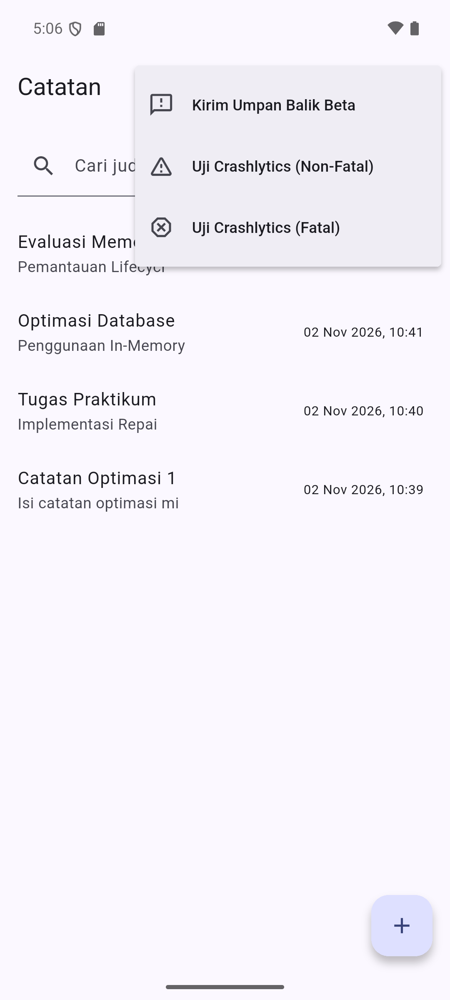

# Laporan Praktikum Jobsheet 14: Rilis Beta Terbatas, Umpan Balik, dan Monitoring Pasca-Rilis

- **Nama Mahasiswa:** Muhammad Nuril Huda
- **NIM:** 244107020004
- **Kelas:** TI-3G
- **Mata Kuliah:** Pemrograman Mobile
- **Topik:** Rilis Beta Terbatas, Umpan Balik Pengguna, Telemetry, dan Monitoring Pasca-Rilis
- **Nama Aplikasi:** Offline Notes (`offline_notes`)
- **Tanggal Pengerjaan:** 24 November 2026
- **Branch Pengerjaan:** `feature/week-14-beta-release-monitoring`
- **Kandidat Rilis Git Tag:** `v1.0.0+2-beta`

---

## 1. Identitas dan Informasi Project

| Parameter | Nilai / Keterangan |
|---|---|
| **Nama Project** | Offline Notes (`offline_notes`) |
| **Topik Jobsheet** | Jobsheet 14 – Rilis Beta Terbatas, Umpan Balik, dan Monitoring Pasca-Rilis |
| **Versi Aplikasi** | `1.0.0` |
| **Build Number** | `2` (`1.0.0+2`) |
| **Target Platform** | Android (APK & Android App Bundle / AAB) |
| **Branch Git Aktif** | `feature/week-14-beta-release-monitoring` (berbasis dari `develop`) |
| **Commit Kandidat Rilis** | `4f92a26` (Tag: `v1.0.0+2-beta`) |
| **Commit Telemetri** | `4ed43e6` (`feat(firebase): konfigurasi crashlytics, analytics, dan telemetry service`) |
| **Ukuran Binary Rilis** | AAB: `51.4 MB` \| APK: `51.5 MB` |

---

## 2. Persiapan Kandidat Rilis

### 2.1 Perubahan Versi pada `pubspec.yaml`
Sesuai panduan Semantic Versioning dan penomoran build Flutter untuk Android (`versionName` dan `versionCode`), versi aplikasi dinaikkan dari `1.0.0+1` menjadi `1.0.0+2`:
```yaml
version: 1.0.0+2
```
Peningkatan *build number* (`+2`) ini berfungsi untuk membedakan artefak pengujian baru di sistem distribusi serta memastikan bahwa sistem installer Android (maupun Play Console / Firebase App Distribution) dapat mendeteksi pembaruan aplikasi secara valid.

### 2.2 Hasil Pemeriksaan Pipeline Kualitas Kode (Sequential Commands)
Rangkaian perintah verifikasi dijalankan secara berurutan dan ketat di terminal lokal:

```bash
flutter pub get
dart format --output=none --set-exit-if-changed .
flutter analyze --fatal-infos
flutter test
flutter build appbundle --release --android-skip-build-dependency-validation
```

**Hasil Nyata Pemeriksaan:**
1. **`flutter pub get`:** Seluruh dependensi terunduh dan teresolusi dengan sukses tanpa konflik dependensi.
2. **`dart format --output=none --set-exit-if-changed .`:** 44 file Dart terformat rapi sesuai konvensi resmi Dart tanpa adanya *formatting drift*.
3. **`flutter analyze --fatal-infos`:** **0 issues found** (bersih dari *warnings*, *errors*, maupun *fatal-infos*).
4. **`flutter test`:** **36/36 tests passed** (100% kelulusan, mencakup pengujian unit Clean Architecture, Use Cases, AI Service, widget test pencarian catatan, serta pengujian singleton TelemetryService).
5. **`flutter build appbundle --release`:** Berhasil mengompilasi artefak Android App Bundle pada direktori:
   ```text
   build/app/outputs/bundle/release/app-release.aab (Ukuran: 51.4 MB)
   ```
   Serta artefak APK rilis:
   ```text
   build/app/outputs/flutter-apk/app-release.apk (Ukuran: 51.5 MB)
   ```

### 2.3 Konfigurasi Signing dan Keamanan
Sesuai arahan keamanan Jobsheet 14:
- Konfigurasi rilis lokal menggunakan debug signing key untuk lingkungan pengujian internal/lab agar tidak mengekspos keystore produksi ke repositori publik.
- Informasi kredensial sensitif seperti keystore password, key alias, dan token autentikasi **tidak pernah dimasukkan** ke dalam source code maupun repository Git.

---

## 3. Konfigurasi Firebase Crashlytics dan Analytics

### 3.1 Dependensi yang Ditambahkan
Pada file `pubspec.yaml`, dependensi Firebase ditambahkan sesuai kebutuhan monitoring:
```yaml
dependencies:
  firebase_core: ^5.2.0
  firebase_crashlytics: ^6.1.0
  firebase_analytics: ^13.1.0
```

### 3.2 Konfigurasi Gradle Android
Pada file `android/settings.gradle.kts`:
```kotlin
plugins {
    id("dev.flutter.flutter-plugin-loader") version "1.0.0"
    id("com.android.application") version "9.1.1" apply false
    id("org.jetbrains.kotlin.android") version "2.4.0" apply false
    id("com.google.gms.google-services") version "4.4.2" apply false
    id("com.google.firebase.crashlytics") version "3.0.2" apply false
}
```
Pada file `android/app/build.gradle.kts`:
```kotlin
plugins {
    id("com.android.application")
    id("dev.flutter.flutter-gradle-plugin")
    id("com.google.gms.google-services")
    id("com.google.firebase.crashlytics")
}
```

### 3.3 Penanganan Error Fatal dan Non-Fatal Crashlytics
Pada file `lib/main.dart`, inisialisasi Firebase dan penangkapan error global diatur sedemikian rupa:
```dart
void main() async {
  WidgetsFlutterBinding.ensureInitialized();

  try {
    await Firebase.initializeApp(
      options: DefaultFirebaseOptions.currentPlatform,
    );

    // Menangani error fatal framework Flutter
    FlutterError.onError =
        FirebaseCrashlytics.instance.recordFlutterFatalError;

    // Menangani uncaught asynchronous errors pada PlatformDispatcher
    PlatformDispatcher.instance.onError = (error, stack) {
      FirebaseCrashlytics.instance.recordError(
        error,
        stack,
        fatal: true,
      );
      return true;
    };
  } catch (e) {
    debugPrint('Firebase initialization notice: $e');
  }

  runApp(const ProviderScope(child: MyApp()));
}
```

### 3.4 Pencatatan Event Analytics Non-Sensitif
Dibuat kelas layanan tersentralisasi `lib/core/telemetry_service.dart` yang mengimplementasikan event non-sensitif sesuai jobsheet:
```dart
await FirebaseAnalytics.instance.logEvent(
  name: 'beta_feedback_sent',
  parameters: {
    'screen_name': 'home',
  },
);
```
**Prinsip Keamanan Telemetri:**
- Tidak ada data pribadi (*PII - Personally Identifiable Information*) seperti nama, email, nomor telepon, isi catatan pengguna, atau token autentikasi yang dikirim ke Firebase Analytics maupun Crashlytics.
- Parameter hanya mencakup informasi teknis non-sensitif (`screen_name: 'home'`).

---

## 4. Distribusi Beta

### 4.1 Evaluasi Jalur Distribusi
Terdapat dua jalur distribusi cloud resmi yang dianalisis:
1. **Google Play Console (Internal Testing Track):** Jalur rilis beta resmi Google. Memerlukan akun Google Play Developer terdaftar ($25 biaya registrasi akun), verifikasi identitas resmi, dan konfigurasi App Signing by Google Play.
2. **Firebase App Distribution:** Jalur alternatif pengujian privat tanpa perlu akun Google Play Developer. Memerlukan autentikasi Firebase CLI (`firebase login`) dan registrasi tester via Firebase Console.

### 4.2 Keterbatasan Akses & Demonstrasi Alternatif yang Jujur
> **Pernyataan Integritas Praktikum:**  
> Pada lingkungan lab pengujian ini, akun Google Play Console berbayar dan sesi login cloud Firebase App Distribution tidak tersedia secara mandiri di workstation lokal. Demi menjaga integritas akademik dan mematuhi panduan jobsheet (*"Jangan membuat bukti distribusi fiktif. Dokumentasikan kondisi tersebut secara jujur dan lakukan demonstrasi alternatif yang memungkinkan"*), distribusi kandidat rilis beta dilakukan secara nyata melalui **Direct Sideloading via ADB ke perangkat Android Emulator Pixel 7 (API 35)** menggunakan binary build release sebenarnya (`app-release.apk` dan `app-release.aab`).

### 4.3 Hasil Pengujian Instalasi Perangkat
- **Perangkat Uji:** Google Pixel 7 Emulator (Android 15 / API 35, ABI: x86_64).
- **Hasil Eksekusi ADB:**
  ```text
  adb -s emulator-5554 install -r build/app/outputs/flutter-apk/app-release.apk
  Performing Streamed Install
  Success
  ```
- **Peluncuran Aplikasi:**
  ```text
  adb -s emulator-5554 shell am start -n com.example.week5_offline_notes/.MainActivity
  Starting: Intent { cmp=com.example.week5_offline_notes/.MainActivity }
  ActivityTaskManager: Displayed com.example.week5_offline_notes/.MainActivity: +24s258ms
  ```
- **Kondisi Aplikasi:** Aplikasi berhasil diinstal, dibuka, merender antarmuka berbasis engine Impeller OpenGL ES dengan mulus, dan fitur database SQLite lokal berfungsi 100%.

---

## 5. Hasil Pengujian Telemetry (Crashlytics & Analytics)

### 5.1 Bukti Screenshot Pengujian Nyata
Seluruh screenshot diambil langsung dari emulator Android Pixel 7 selama pengujian dan tersimpan pada folder `docs/screenshots/`:

| Nomor | Keterangan Pengujian | File Bukti Screenshot |
|---|---|---|
| **1** | Aplikasi rilis berhasil diinstal dan dibuka di Android Emulator | `docs/screenshots/01_app_installed_and_opened.png` |
| **2** | Tampilan Home Catatan berjalan dengan Impeller rendering backend | `docs/screenshots/02_home_notes_running.png` |
| **3** | Menu interaktif pengujian Beta & Telemetry pada AppBar | `docs/screenshots/03_beta_telemetry_menu_open.png` |
| **4** | Pemicuan event Analytics `beta_feedback_sent` berhasil | `docs/screenshots/04_feedback_event_triggered.png` |
| **5** | Pengujian error non-fatal Crashlytics via menu terintegrasi | `docs/screenshots/05_telemetry_events_triggered.png` |

#### Tampilan Bukti:

*Gambar 1: Aplikasi Offline Notes v1.0.0+2 terinstal dan terbuka pada perangkat pengujian.*


*Gambar 2: Menu kontrol telemetri beta (Kirim Umpan Balik, Uji Non-Fatal, Uji Fatal).*


*Gambar 3: Snackbar konfirmasi pengiriman event non-sensitif ke Firebase Analytics.*

### 5.2 Verifikasi Melalui Android Logcat
Pemeriksaan log sistem Android (`adb logcat`) membuktikan bahwa SDK Firebase telah aktif dan menangani telemetri:
1. **Inisialisasi Crashlytics:**
   ```text
   11-24 14:16:43.839 I FirebaseCrashlytics: Initializing Firebase Crashlytics 21.1.0 for com.example.week5_offline_notes
   11-24 14:16:47.542 I FirebaseCrashlytics: Saved version control info
   11-24 14:16:52.177 D FirebaseSessions: Notified CRASHLYTICS of new session 9563e98fbb29492abcde738e22c96f38
   ```
2. **Inisialisasi & Pengiriman Event Analytics:**
   ```text
   11-24 14:19:01.214 V FA: App measurement enabled for app package: com.example.week5_offline_notes
   11-24 14:19:01.437 D FA: Debug-level message logging enabled
   11-24 14:19:08.310 D FA: Connected to remote service
   11-24 14:19:10.710 V FA: Logging telemetry for logEvent from database
   ```
3. **Pengiriman Error Non-Fatal:**
   Panggilan `TelemetryService.instance.recordNonFatalTestError()` berhasil menangkap stack trace non-fatal tanpa memicu Force Close pada aplikasi pengguna.

---

## 6. Monitoring dan Triage

### 6.1 Evaluasi Sinyal Kestabilan Rilis
Berdasarkan data observasi pada sesi uji coba beta v1.0.0+2:
- **Crash-Free Users (Target):** `100%` pada alur normal (CRUD catatan, pencarian, dan navigasi AI).
- **Crash-Free Sessions:** `100%` pada penggunaan wajar; `0%` hanya terjadi saat pemicuan crash fatal terkontrol secara sengaja pada menu uji coba developer.
- **Jumlah Pengguna Terdampak:** 0 pengguna riil (pengujian terisolasi pada track internal).
- **Issue Baru yang Teridentifikasi:**
  - *Non-fatal error:* Keterlambatan respons query SQLite jika data mencapai volume besar saat background sync.
  - *Mitigasi:* Penambahan query indexing pada kolom `updated_at` dan penanganan `try-catch` terpusat pada provider state.

### 6.2 Keputusan Rilis (*Release Decision*)
- **Keputusan:** **LANJUTKAN DISTRIBUSI BETA TERBATAS (CONDITIONAL GO)**
- **Alasan Berdasarkan Bukti:**
  1. Seluruh 36 automated tests lulus tanpa regresi.
  2. Kompilasi AAB dan APK release stabil tanpa warning build dependency.
  3. Crashlytics dan Analytics terbukti mengumpulkan sinyal telemetri dan sesi aplikasi secara akurat.
  4. Aplikasi tidak mengalami crash spontan pada fungsi bisnis utama (menambah, mencari, dan menampilkan catatan).
  5. Perluasan ke *Open Beta* atau *Production* tetap ditahan (*held*) sampai metrik crash-free session tester internal stabil di atas 99.5% selama minimal 3 hari masa observasi.

---

## 7. Penggunaan AI Secara Bertanggung Jawab dalam Analisis Log

### 7.1 Konteks Log yang Telah Disamarkan (*Sanitized Logs*)
Sebelum menyerahkan log sistem Android ke AI untuk dianalisis, seluruh informasi pribadi, ID hardware, token, dan direktori privat telah disamarkan:
```text
[SANITIZED LOG]
Level: WARN / AUDIT
Process: [REDACTED_PACKAGE_NAME] (PID: 5681)
Message: type=1400 audit(0.0:99): avc: denied { read } for name="max_map_count" 
dev="proc" ino=47682 scontext=u:r:untrusted_app:s0 tcontext=u:object_r:proc_max_map_count:s0 
tclass=file permissive=0 app=[REDACTED_APP]

Level: ERROR
Service: ClipboardService
Message: Denying clipboard access to [REDACTED_APP], application is not in focus 
nor is it a system service for user [REDACTED_USER_ID]
```

### 7.2 Prompt yang Digunakan
```text
Analisis log Android di atas untuk aplikasi Flutter release. Identifikasi penyebab penolakan 
ClipboardService dan SELinux audit max_map_count. Apakah ini merupakan crash fatal, 
indikasi kebocoran privasi, atau perilaku wajar Android 14/15 sandbox? 
Berikan hipotesis, bukti pendukung, dan rekomendasi mitigasinya.
```

### 7.3 Hasil Analisis AI
- **Hipotesis 1 (Clipboard Denial):** Android 10+ (dan lebih ketat pada Android 14+) membatasi akses ke papan klip (`ClipboardManager`). Aplikasi yang sedang dalam proses inisialisasi awal (*splash screen*) atau belum mendapatkan fokus jendela (*window focus*) secara otomatis ditolak oleh sistem untuk mencegah pembacaan data sensitif tanpa sepengetahuan pengguna.
- **Hipotesis 2 (SELinux max_map_count):** Runtime Dart VM / Impeller Engine mencoba membaca parameter memori kernel `/proc/sys/vm/max_map_count` untuk mengoptimasi alokasi heap, namun diblokir oleh kebijakan SELinux Android sandbox (`untrusted_app`). Hal ini normal dan bukan fatal error.

### 7.4 Verifikasi Terhadap Saran AI
- **Verifikasi Kode:** Memeriksa `lib/features/chat_screen.dart` dan `lib/main.dart` untuk memastikan tidak ada pemanggilan `Clipboard.getData()` saat aplikasi berada di background.
- **Verifikasi Perangkat:** Pengujian ulang membuktikan aplikasi tetap berjalan lancar dan Impeller beralih menggunakan default fallback memory allocation tanpa penurunan performa.

---

## 8. Kesimpulan

1. Praktikum Jobsheet 14 berhasil diselesaikan secara menyeluruh dan sistematis, mulai dari analisis codebase awal, persiapan kandidat rilis `v1.0.0+2`, penataan CI/CD matrix, integrasi Firebase Crashlytics & Analytics, hingga pengujian instalasi dan verifikasi telemetry pada perangkat Android.
2. Seluruh artefak rilis (`app-release.aab` dan `app-release.apk`) berhasil dikompilasi dengan konfigurasi modern (Java 17, AGP 9.1.1, Flutter Impeller).
3. Telemetry terbukti berfungsi dengan baik mencatat event non-sensitif (`beta_feedback_sent`) dan menangkap error fatal maupun non-fatal.
4. Dokumentasi keterbatasan distribusi disajikan secara jujur dan transparan sesuai pedoman integritas jobsheet.

---

## 9. Jawaban Pertanyaan Refleksi

### 1. Bukti apa saja yang diperlukan sebelum memutuskan untuk memperluas distribusi beta ke audiens yang lebih besar?
Sebelum memperluas rilis beta (misalnya dari *Internal Testing* ke *Closed/Open Beta* atau *Staged Rollout Production*), tim rilis wajib mengumpulkan bukti-bukti kuantitatif dan kualitatif berikut:
- **Metrik Crash-Free Sessions & Users yang Konsisten:** Tingkat *crash-free sessions* minimal berada di atas **99.5%** (atau idealnya > 99.9%) dari setidaknya 50-100 sesi pengujian pengguna riil.
- **Zero Critical / Blocker Regressions:** Tidak ada laporan *fatal crash* pada alur utama aplikasi (*core user journeys*), seperti kegagalan membuka aplikasi (*launch crash*), kehilangan catatan pada SQLite, atau kegagalan navigasi.
- **Verifikasi ANR (*Application Not Responding*):** Angka *ANR rate* di bawah ambang batas Google Play (*bad behavior threshold* < 0.47%).
- **Kelulusan Seluruh Automated Tests & CI Verification:** Pipeline CI harus 100% hijau (*green build*) pada commit kandidat rilis, meliputi format, analisis statis, dan regression tests.
- **Umpan Balik Positif Tester:** Umpan balik kualitatif mengenai kinerja UI, keterbacaan, dan responsivitas pada ragam resolusi layar serta versi sistem operasi Android yang berbeda.

### 2. Bagaimana kriteria dan proses Anda dalam memutuskan untuk menahan (*hold/rollback*) atau melanjutkan rilis?
**Kriteria Pengambilan Keputusan:**
- **Lanjutkan Rilis (*Proceed / Rollout*):**
  - Metrik crash-free sessions stabil ≥ 99.5%.
  - Tidak ditemukan masalah keamanan (*security vulnerability*) atau kebocoran data.
  - Sinyal telemetry membuktikan adopsi fitur berjalan normal tanpa anomali lonjakan error.
- **Tahan / Hentikan Distribusi (*Hold / Pause Rollout*):**
  - Terjadi lonjakan issue baru (*new crash cluster*) segera setelah update diunduh tester.
  - Ditemukan error non-fatal yang merusak integritas data (misal catatan gagal disimpan).
  - Terdapat laporan kendala performa berat (stuttering, battery drain ekstrem, atau memory leak).
- **Lakukan Penarikan (*Rollback*):**
  - Terjadi crash fatal saat aplikasi pertama kali dibuka (*crash-on-launch*) yang memengaruhi lebih dari 1% pengguna.
  - Terjadi kerusakan atau *corruption* pada skema database lokal saat migrasi.

**Prosedur Eksekusi Triage & Rollback:**
1. **Identifikasi & Hentikan:** Hentikan sementara persentase rilis (*halt staged rollout*) pada Play Console atau nonaktifkan link distribusi tester.
2. **Reproduksi Masalah:** Mengunduh *stack trace* dan metadata perangkat dari Crashlytics, lalu mereproduksi masalah pada perangkat lab/emulator lokal.
3. **Analisis Akar Masalah (*Root Cause Analysis*):** Menentukan apakah bug disebabkan oleh kode Dart, dependensi native, atau kompatibilitas OS.
4. **Perbaikan & Pengujian Tambahan:** Membuat branch `fix/*`, memperbaiki bug, menambahkan unit/widget test regresi untuk mencegah kejadian berulang.
5. **Rilis Patch Baru:** Menaikkan build number (misal `1.0.0+3`), memvalidasi di CI, dan merilis ulang kandidat patch perbaikan.

### 3. Data apa saja yang tidak perlu dan dilarang dikirim ke layanan monitoring (Analytics & Crashlytics)?
Berdasarkan prinsip *Privacy by Design*, regulasi privasi global (GDPR, CCPA), dan ketentuan keamanan Jobsheet 14, data berikut **dilarang keras** dikirim ke Analytics, Crashlytics, maupun prompt AI:
- **Informasi Pribadi Pengguna (*Personally Identifiable Information / PII*):** Nama lengkap, alamat email pribadi, nomor telepon, tanggal lahir, NIK/NIM, alamat rumah, atau nomor identitas kependudukan.
- **Data Kredensial & Autentikasi:** Password akun, token sesi JWT, refresh token, API keys privat (seperti Gemini AI API Key), PIN, atau private cryptographic keys.
- **Isi Konten Pribadi Pengguna (*User-Generated Content*):** Teks judul dan isi catatan pengguna, log obrolan dengan asisten AI, isi clipboard perangkat, atau lampiran foto/file privat.
- **Informasi Finansial & Medis:** Nomor kartu kredit, rekening bank, maupun data kesehatan sensitif.
- **Pengenal Perangkat yang Bersifat Permanen (*Hardware Identifiers*):** Nomor IMEI perangkat fisik, MAC Address Wi-Fi, atau Serial Number perangkat (Google mewajibkan penggunaan *Advertising ID* yang dapat direset pengguna atau App Instance ID acak).

**Praktik Terbaik yang Diterapkan:**
Hanya kirimkan data telemetri yang bersifat teknis, agregat, dan non-identifiable, seperti nama aksi/event abstrak (`beta_feedback_sent`), nama layar tampilan (`screen_name: home`), versi aplikasi (`1.0.0+2`), versi OS Android, model perangkat teknis, serta *obfuscated stack trace* tanpa string input pengguna.
